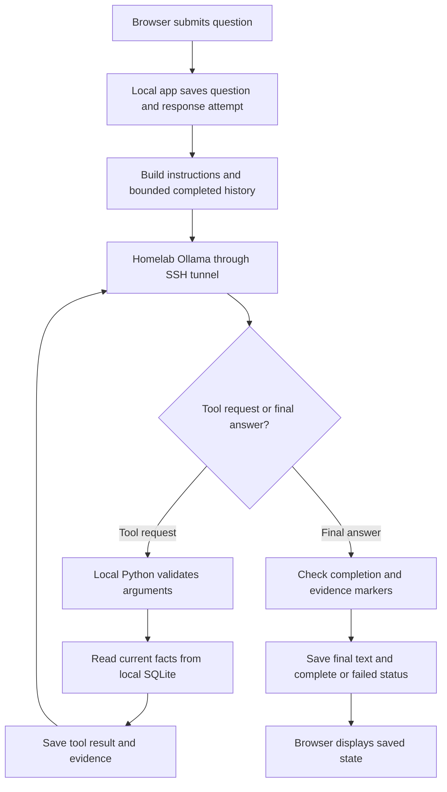

# Chat investigation handoff

Date: 20 September 2026 · Workspace: `jdsg-knowledge-graph-shopping`

## Start here

The `/chat` problem is only partially fixed. The investigation found both answer
quality gaps and failures that can disable subsequent Chat generation. The user
has explicitly requested review and planning **without further implementation**.
This handoff and the accompanying synthetic reproduction scripts are documentation
artifacts; they do not authorize source changes, commits, or deployment.

Read this document before continuing the
[proposed remediation plan](../plans/chat-reliability-and-answer-quality.md).
That plan predates the broader lifecycle review: prioritize findings **R1–R3**
below before its monthly-lookup work. The proposed fifth read tool is a scope
change awaiting acceptance for implementation.

The user previously requested a Luna subagent at low reasoning effort for the
earlier fix. Preserve that preference if implementation is requested again; the
later instruction to stop implementation remains the current instruction.

## User reports and environment

- Every Chat send appeared to end with `Response failed · incomplete`.
- For `hello world`, a normal assistant greeting appeared, followed by:
  `The response did not include a verified purchase link. Retry the question.`
- The user subsequently populated development with actual purchase data and said
  replies were not meaningful. Their concrete query was:
  **“what are the items i bought last month”**.
- The reported setup runs the app and SQLite on the Mac, with an SSH tunnel from
  local `127.0.0.1:11434` to homelab Ollama. Earlier synthetic checks established
  inference through that tunnel. This handoff is not a fresh service inventory.
- Earlier observed provider: Ollama `0.30.10`, `qwen3.5:9b`, `think: false`;
  model digest `6488c96fa5faab64bb65cbd30d4289e20e6130ef535a93ef9a49f42eda893ea7`.
  The current token counter deliberately accepts only the verified version/model
  combination. An alias is not a guarantee of immutable model contents.

The exact tool sequence and answer for the user's real-data month query have not
been inspected. Structural gaps and synthetic reproductions below must not be
presented as proof of what happened in that particular attempt.

## Repository state at handoff

- Branch: `main`.
- HEAD: `2937d2ac058f6b110323acb3f0a79ae3fb322789`.
- Earlier partial fix is **uncommitted** in these seven files:
  `README.md`, `docs/MVP_PLAN.md`, `src/shopping/assistant/runtime.py`,
  `src/shopping/web/static/chat.js`, `tests/assistant/test_assistant_runtime.py`,
  `tests/browser/chat_draft_recovery.js`, `tests/web/test_chat_streaming.py`.
- Existing untracked plan:
  `.scratch/shopping-assistant/plans/chat-reliability-and-answer-quality.md`.
- SHA-256 of `git diff HEAD --binary` before this documentation work:
  `c2bc749014d723f0f8ab4537962ad27e0c7dd139374a3cee428dc497c02139cd`.
  This covers the tracked diff, not untracked documents.

The read-only reviews left that diff unchanged. Preserve and assess the existing
work rather than reverting or treating all of it as a verified complete fix.
No deployment or restart of the user's app was performed during those reviews.

## Current flow and ownership



Text can stream during model requests. The app checkpoints changed text about
every 250 ms, then publishes it; visible text is provisional until completion.
Model generation finishing successfully does not guarantee application completion.

| Responsibility | Source |
| --- | --- |
| Browser drafts, commands, transcript and reconnect | [chat.js](../../../src/shopping/web/static/chat.js) |
| WebSocket coordination, checkpointing, Stop and terminal persistence | [chat.py](../../../src/shopping/web/chat.py) |
| Tool loop, budgets, cancellation, evidence checks and fallback | [runtime.py](../../../src/shopping/assistant/runtime.py) |
| Instructions, exact token accounting, whole-exchange trimming | [context.py](../../../src/shopping/assistant/context.py) |
| Native Ollama requests and streamed response parsing | [ollama.py](../../../src/shopping/assistant/ollama.py) |
| Tool schemas, validation, cursors and result envelopes | [tools.py](../../../src/shopping/assistant/tools.py) |
| Application-owned SQL reads | [queries.py](../../../src/shopping/purchases/queries.py) |
| Durable messages, attempts, tools and lifecycle transitions | [conversations.py](../../../src/shopping/assistant/conversations.py) |

Only four read tools currently exist: `search_products`, `get_product_history`,
`list_recent_orders`, and `get_order`. The model chooses calls; Python validates
and executes them. Importing purchases does not automatically put all records into
the model's context.

Limits are one active attempt globally, 4 model requests, 8 proposed tool calls,
180 seconds work plus 5 seconds cleanup, 6,912 input tokens, 768 generated tokens
per request, and 4 KiB whole-row tool envelopes. Context initially selects up to
16 completed earlier exchanges / 256 KiB, then exact token accounting can drop
more whole exchanges. Failed assistant output is excluded.

## Confirmed findings

### R1 — P1: Stop racing with a tool result can fault all Chat generation

**Trigger:** Submit Stop after a read starts but while its result is returning.

**Cause:** Runtime collects the result's evidence before publishing the tool
outcome. Stop can hold the web coordination lock first. The outcome callback then
sees `stopping` and skips persistence (`chat.py:546–547`). Terminal handling keeps
the saved text but forwards the runtime's unsaved evidence (`chat.py:593–605`).
`conversations.checkpoint()` rejects evidence absent from saved tool results
(`conversations.py:369–376`). The generic exception handler faults generation.

**Observed:** Stop acknowledged as `stopping`; error
`persistence_or_runtime_failure`; availability `faulted`; saved attempt still
`stopping`; tool result absent. Further generation requires an app restart.

**Evidence:** [stop_race.py](chat-review-repros/stop_race.py) uses the real runtime,
read tool, persistence and WebSocket boundary with a fake model and temporary
synthetic database. A 150 ms injected delay forces the possible ordering. Both
reviewer and primary agent reproduced it; occurrence frequency in normal use is
unknown.

**Repair target:** Reconcile stopped terminal text/evidence with durable tool
records. Keep ordinary cancellation isolated to its response; retain protection
against genuinely unsettled cleanup. Add the race as a regression test.

### R2 — P1: A marker-only answer can fault all Chat generation

**Trigger:** Model returns only `[[unsupported]]` or `[[clarification]]`.

**Cause:** `_complete()` checks nonempty text before stripping the mode prefix and
then returns `complete` with empty text (`runtime.py:51–82`). Persistence correctly
rejects an empty completed response (`conversations.py:362–365`), but the web
handler treats this as a global fault rather than a failed response.

**Observed:** Runtime returned `complete` with text length 0. WebSocket handling
reported `persistence_or_runtime_failure`, saved status stayed `running`,
availability became `faulted`, and the next submission was rejected as `faulted`.

**Evidence:** [empty_mode.py](chat-review-repros/empty_mode.py) reproduces the full
runtime-to-storage mismatch in a temporary empty database, without Ollama.

**Repair target:** Validate the final user-visible text before returning complete;
contain malformed model output to one attempt. Preserve explicit incomplete
outcomes instead of weakening storage validation.

### R3 — P2: A failed conversation switch clears the wrong UI state

**Trigger:** Conversation A is selected; the user selects a stale/deleted B entry;
the server returns `error {code: "gone"}` for that subscribe command.

**Cause:** `select()` tracks the command ID but not its target. The error handler
calls `gone(selected || restored)` (`chat.js:269`), which still identifies A.
The server's error has the command ID but no target conversation ID.

**Observed:** The client clears A from its selection and displayed library, leaves
B in the library, and displays “Conversation deleted.” **A's stored data is not
deleted.** The server also changes the peer subscription before attempting the
snapshot (`chat.py:404–405`), so repair should consider both sides of the switch.

**Evidence:** [missing_conversation.cjs](chat-review-repros/missing_conversation.cjs)
executes the shipped browser handlers in a Node VM with a minimal fake DOM and
transport. It produces `selected: null` and `libraryIds: ["B"]`. This is a client
handler reproduction, not a complete real-browser integration test.

**Repair target:** Correlate the failed selection with B, preserve valid A state,
and restore/maintain a consistent server subscription after failed switching.

### R4 — P1: Ordinary conversation still fails evidence checks

The partial fix's `_GREETING` matches exact phrases such as `hello`, `hi`, and
`good morning`; it does not match `hello world`. Benign uncited model replies to
`hello world`, `Thanks`, `What can you do?`, and a natural clarification were
replayed through `run_attempt` and returned `missing_evidence`.

There is no general nonfactual conversation mode in the current instructions.
Only specially prefixed clarification/unsupported replies bypass purchase links.
With no lookup results, the fallback cannot help. This directly reproduces the
user's greeting symptom and remains unresolved.

**Repair target:** Define ordinary conversation, clarification, refusal and factual
answer behavior explicitly. Mixed greeting/purchase requests still require fresh
reads. Extending an input phrase allowlist does not resolve the general contract.

### R5 — Capability gap: Last-month item listing lacks date context and retrieval

`context.py` supplies no application-owned current date. The four tools have no
month/date-range argument. `list_recent_orders` returns order headers, while
`get_order` returns one order's items. Product history requires a known product.

The model would need to discover matching orders and fetch each separately. Even
nine matching orders exceed eight tool calls before accounting for discovery and
pagination. This is recorded-item retrieval, not unsupported spending analytics.

**Proposed remedy:** Freeze Singapore date context once per attempt and add one
bounded `list_purchase_items(month="YYYY-MM", limit=10, cursor=...)` tool, maximum
20 rows subject to the existing 4 KiB envelope. On 20 September 2026, last month is
1–31 August; filter delivery timestamps in UTC interval
`[2026-07-31T16:00:00+00:00, 2026-08-31T16:00:00+00:00)`.

Keep current revisions, include `placed`, retain repeated purchase lines, and
report missing dates honestly. Show a useful partial page with continuation; do
not increase global budgets to fetch an entire month through individual orders.
Continuation must preserve the resolved month and original limit across turns,
including calendar rollover. This fifth tool is proposed, not implemented or
accepted as a revised scope yet.

### R6 — P2: The generic fallback can discard the requested facts

`_recorded_fallback()` (`runtime.py:85–167`) renders total/net line amount but omits
available unit prices, fees, subtotal, discounts, taxes and retailer order
reference. It has no question-specific interpretation.

A synthetic lookup contained delivery fee 250 cents, subtotal 1,150 cents and
total 1,400 cents. An uncited answer about the SGD 2.50 delivery fee was replaced
by a completed fallback showing only the SGD 14.00 total. Retrieval succeeded;
the requested field was lost.

Another synthetic case used an existing product with no current-history rows.
The fallback counted parent product metadata as a row and returned only its
name/link, without saying the history was empty (`runtime.py:117–123`).

**Repair target:** Preserve requested fields and empty/partial meanings. A successful
read or record dump alone must not certify that the question was answered. The
planned exact monthly listing can use deterministic rendering of validated rows.

## Earlier partial fix: retain versus revisit

**Valid correction:** Provider IDs such as `call-0` previously became persisted
IDs like `1:call-0`, which fail the storage regex `[0-9]{1,2}:[0-9]{1,3}`. Runtime
now uses numeric batch positions such as `1:0` (`runtime.py:256`). An integrated
runtime → WebSocket → persistence → reload test verifies this correction.
The earlier broad exception mapping obscured the original rejection as
`context_unavailable`; safe failure categories still need better separation.

**Partial/unreliable pieces:** Exact-greeting shortcut; generic recorded-results
fallback; acceptance checks that count that fallback as proof of answer quality.
UI messages for missing evidence/context failures improve explanation but do not
resolve the underlying failures. README/MVP additions currently describe the
partial implementation and need revision when behavior actually changes.

The correction is not a reason to revert the whole patch; the passing checks are
not a reason to call the whole Chat feature fixed.

## Design limits and ruled-out findings

- **Reference validation is not semantic grounding.** A valid order marker does
  not prove every statement. A synthetic `[[clarification]]` prefix followed by
  invented shopping facts also passed mechanical completion. Explicit response
  modes/structured output do not by themselves prove factual correctness.
- **Search is narrow.** It matches contiguous text in canonical names only; no
  alternative wording, SKU, or raw-item-name matching is exposed by that tool.
  Same display names can represent different retailer/SKU identities, but search
  candidates lack distinguishing retailer/SKU labels. These are capability limits,
  not proven causes of the user's month-query failure.
- **Pagination constraints are deliberate.** Cursors bind database, tool,
  arguments and limit, and expire on app restart. Omitting a nondefault limit on
  continuation fails validation. Offset pages read live facts; concurrent ingestion
  can shift pages. Do not promise an immutable month snapshot.
- **Reconnect history is not lost.** The initial snapshot intentionally includes
  one latest attempt; Older retrieves earlier saved attempts. A synthetic two-turn
  check verified both remained stored.
- **Repeated Older clicks were not confirmed as a defect.** An initial candidate
  was withdrawn: server serialization preserves response ordering and the client
  deduplicates attempts. Do not carry it forward as a finding.
- **Hanging token-fetch/handshake timeout is unverified.** A missing client timeout
  was noted as a follow-up candidate only; it was not reproduced or prioritized.
- Disconnect does not cancel generation. Reconnect retrieves saved state without
  resubmitting; explicit Retry creates a fresh attempt for the original message.

## Reproduction commands and validation evidence

Run from the repository root with its existing environment. The three scripts
below are archived investigation probes, not committed regression tests or fixes.
They use synthetic data/fake model responses and make no real Ollama request.
Their assertions describe desired behavior and **currently exit nonzero because
they reproduce bugs**. Python databases are temporary; the Node probe only reads
the shipped JavaScript and evaluates it in an isolated VM.

```bash
PYTHONDONTWRITEBYTECODE=1 .venv/bin/python .scratch/shopping-assistant/research/chat-review-repros/stop_race.py
PYTHONDONTWRITEBYTECODE=1 .venv/bin/python .scratch/shopping-assistant/research/chat-review-repros/empty_mode.py
node .scratch/shopping-assistant/research/chat-review-repros/missing_conversation.cjs
```

Latest focused baseline run during the broader review:

```bash
PYTHONDONTWRITEBYTECODE=1 .venv/bin/python -m pytest -q -p no:cacheprovider \
  tests/assistant tests/web/test_chat_streaming.py tests/web/test_chat_web.py
```

Result: **92 passed**, one dependency deprecation warning, about 3.9 seconds.
The new probes expose gaps that this existing suite does not cover.

Earlier, during the partial-fix phase, the wider suite reported **287 passed,
1 skipped**; formatting, lint, type, secret checks and isolated built-wheel
migration verification passed. A synthetic real-Qwen order-total smoke passed
(first/warm requests approximately 21.85/6.49 seconds), and an isolated browser
flow returned a latest-order answer. These are historical, narrowly scoped checks,
not fresh verification of the proposed fixes or of meaningful real-data answers.
The smoke can pass through deterministic fallback, so it does not prove model
citation compliance. The temporary browser/server were closed afterward.

## Recommended next work after implementation is requested

1. Turn R1 and R2 into focused regression tests, then repair terminal-state
   consistency and isolate malformed model responses. Completion criterion:
   correct stopped/failed status, no unsaved evidence, and the next valid send works.
2. Fix R3 on both client selection and server subscription boundaries. Completion
   criterion: failing to open B preserves A, removes only the stale B entry, and
   later A updates still arrive.
3. Replace the greeting/evidence contract and repair empty/fallback semantics.
   Verify the proposed output protocol with the installed model before relying on
   native structured-output behavior. Keep all attempts within existing budgets;
   no hidden repair-generation loop.
4. Implement the accepted form of the month-item query and date context. Verify
   timezone boundaries, January rollover, current revisions, repeated lines,
   missing dates, empty months, more than eight orders, and continuation.
5. Verify the exact user question through synthetic real-model and browser flows.
   Assert requested names/quantities/dates and wrong-month exclusions, not merely
   `complete` or the presence of a link. Then perform a private operator acceptance
   check against the intended development database and report only the outcome.

Use the [existing plan](../plans/chat-reliability-and-answer-quality.md) for file
ownership and broader acceptance cases, updated with R1–R3. Keep evaluation small,
as required by [ticket 09](../issues/09-plan-implementation-slices.md). Local checks
do not complete [homelab verification ticket 18](../issues/18-verify-homelab-chat-mvp.md).

## Constraints and open questions

Follow [AGENTS.md](../../../AGENTS.md) and read README, MVP and deployment docs
before changing scope. Preserve SQLite authority, append-only facts, exact money,
the delivery-date Purchase-date convention, short transactions, private file
permissions, loopback listeners, protected Chat access and current deployment
rollback. Keep the installed model and existing lightweight architecture unless a
measured problem motivates an explicitly accepted change.

Actual development purchases are private. The later review did not inspect private
database contents, environment values, logs, or real-data model answers. Fixtures,
probe outputs and this document contain only synthetic examples. Keep further
private validation output out of Git, logs, screenshots and model research.

Still unverified: the precise failure path for the user's real-data query; whether
the running app has loaded the earlier patch; frequency of the two global-fault
triggers under normal use; the proposed response protocol's reliability on Qwen;
and live homelab service/Tailscale acceptance. No fix for these review findings has
been implemented, committed or deployed.
