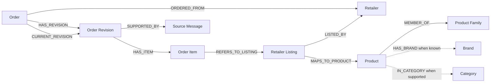

# Shopping knowledge graph: model investigation

Date: 20 September 2026
Status: Model decisions accepted and ticket 20 resolved. Implementation and forecasting remain pending.

The [accepted model specification](../specs/shopping-knowledge-graph-model.md) is
the consolidated contract. This report preserves research, actual-data findings,
and illustrative representation details; it does not certify implemented behavior.

## Goal and current direction

The operator wants to structure shopping data as a knowledge graph before adding
more Chat tools. Chat remediation remains documented but is deferred while this
model is explored. The operator has now clarified the first use: track how often
particular items are purchased and support predictions of future purchases. The
graph therefore needs distinct order, delivery, and evidence timing plus stable
product/occurrence identity. The operator subsequently chose **delivery date** as
Purchase Date for this analysis. The forecast target is therefore the next likely
delivery-based Purchase Date; order-placement timing and inventory depletion are
separate questions requiring lead-time or consumption information.
The operator then requested Product Family in the initial scope and accepted the
recommended recorded-purchase eligibility and occurrence-counting rules. The final
family round accepted grouping the same product type across brands/sizes and
reviewing suggested memberships before use. Individual assignments remain subject
to review; no live family records have been created.

The existing archive/parser/SQLite work is a useful foundation. What is missing
is an explicit graph vocabulary, identity and provenance rules, and a deterministic
projection. A graph visualization or another LLM tool does not establish those rules.

## Recommendation and alternatives

Start with an application-owned **property graph**: nodes have types and properties;
directed edges have named meanings and can carry evidence. Keep SQLite authoritative
and make graph artifacts rebuildable. This fits the current local Python workflow.

| Option | Fit for this project | Recommendation |
| --- | --- | --- |
| Typed property graph projected from SQLite, initially plain node/edge records | Keeps existing factual storage, makes identity/evidence explicit, and supports a later explorer | Start here; no new database required |
| RDF with shared vocabularies and SPARQL | Useful if linked-data interchange, ontology reasoning, or external dataset integration is a concrete goal | Consider if that is the learning goal; it is not required by current shopping questions |
| Dedicated graph database | Could serve graph-specific query or scale requirements | No measured need yet; requires a separate accepted operational plan |

SQLite supports recursive graph traversal. NetworkX `MultiDiGraph` supports
directed parallel edges with attributes if Python algorithms become useful; it
does not enforce the domain model for us. RDF represents facts as triples and
also requires explicit modeling of events and evidence. These are representation
choices, not replacements for the ontology (the agreed entity/relationship meanings).
See the [primary-source comparison](knowledge-graph-representation-options.md),
[SQLite WITH documentation](https://www.sqlite.org/lang_with.html),
[NetworkX MultiDiGraph](https://networkx.org/documentation/stable/reference/classes/multidigraph.html),
and [W3C RDF concepts](https://www.w3.org/TR/rdf11-concepts/).

## Initial factual and family graph



Dashed links are optional enrichment, not facts populated automatically today.
Product Family is initial target scope, but no family records or memberships exist
in the implemented schema yet; the solid family edge describes the target model.
Multiple source messages may support one revision. Multiple items may refer to the
same listing. The current-revision edge is a derived selection, not another order.

| Target node | Existing source / identity | Meaning and useful properties |
| --- | --- | --- |
| Retailer | `retailers.id`, unique slug | Seller identity and display name |
| Order | `orders.id`, unique retailer + external order ID | Logical order; totals/status belong to its revisions |
| Order Revision | `order_revisions.id` | One recorded version: source-event time, delivery time, status, currency, total/fees in cents, parser version |
| Order Item | `order_items.id` | A specific line occurrence in a specific revision: ordinal, raw name, quantity/unit, unit price and net cents |
| Retailer Listing | `retailer_products.id` | Retailer-specific listing/SKU, separate from a cross-retailer product concept |
| Product | `products.id` / canonical key | Intended exact product variant/package; current identities are provisional |
| Product Family | New authoritative family/membership records required; not yet implemented | Named grouping of related Products, with an explicit definition and separately evidenced membership; initial scope accepted |
| Source Message | `email_messages.id` | Local evidence identity; omit email body, headers, addresses, subject and archive path from graph exports |
| Brand / Category | `brands.id` / `categories.id` | Optional enrichment; schema support exists but normal ingestion does not populate it |

Mapping is based on the implemented
[ingestion migration](../../../src/shopping/storage/migrations/001_ingestion.sql),
[persistence](../../../src/shopping/ingestion/store.py), and
[normalization](../../../src/shopping/purchases/normalization.py), not the larger
unimplemented schema sketch in `docs/MVP_PLAN.md`.

## The most important modeling choices

**Keep order-line occurrences as nodes.** Two identical items appearing on two
lines remain two nodes. Quantity and price describe those occurrences, not a Product
for all time. A 1 L package and a 2 L package remain different Products. Do not
discard that distinction when both belong to one Product Family. Do not
reduce the authoritative graph to Order → CONTAINS → Product: that can be a derived
convenience relationship only, with its supporting item IDs.

**Preserve Retailer Listing separately from Product.** Current ingestion creates
provisional products from retailer + SKU, or retailer + normalized whole name when
SKU is absent. The current adapter does not supply SKUs. Normalization is text
cleanup, not proof of equivalent products. Do not merge across retailers, sizes,
variants, aliases, or identical display names automatically. Existing
`match_confidence=1.0` with `match_status=provisional` is not confirmed identity.
Package-size extraction is also a heuristic; it does not normalize multipacks or
prove that differently written units identify the same package.

**Add Product Family above exact Products.** The operator requested this in the
initial scope, superseding the earlier suggestion to postpone it. Membership is
a separate assertion; it does not merge Product identities or rewrite Items.
Families group the same product type across brands/sizes, with materially different
types separate; suggested memberships require review. Family frequency must
union qualifying member occurrences, not add member-product frequency counts.

**Keep source events distinct from imported wrappers.** Use every association in
`order_revision_sources` for `SUPPORTED_BY`; the revision's direct email ID is
only its first source. Reimporting identical bytes should change nothing. A different
wrapper around the same event adds evidence, not another purchase. A later source
event can add a historical revision even if its facts match an earlier version.

**Keep the date meanings separate.** Purchase Date uses delivery date by explicit
operator decision, including frequency analysis and future predictions. Current
`delivery_at` values describe scheduled slots, not verified arrivals. Order Date,
source-event time, wrapper receipt/import time, and graph build time retain their
own meanings. Source-event time orders revision history; it does not replace a
missing Purchase Date. Do not use ingestion order/revision number as business
chronology or fill an unknown `ordered_at` with an email-time estimate.

**Facts, enrichment, and calculated relationships need different evidence.**
Direct order facts trace to revision/item/source rows. A brand/category assignment
needs its own rule, source, or reviewed assertion. Keep origin (extracted, inferred,
manual) separate from review status; accepting an inferred assignment does not
erase how it originated. `HAS_BRAND` expresses brand affiliation, not a claim about
the manufacturer; manufacturer identity would need separate evidence and modeling.
A calculated co-occurrence relationship is
derived, not proof that products are substitutes or that a household needs them.

## Current and historical views

Recommend one factual model with two explicit views:

- The ordinary purchase graph follows `is_current=1`, preserves recorded statuses
  (including `placed`), and keeps unknown delivery dates null. It describes recorded
  order facts, not proof every order was completed or consumed.
- An evidence/history view also includes prior Revision and Item nodes. Traversing
  it must not count every revision as a separate purchase.

Historical item facts retain their raw names and original listing references.
Listing-to-Product mappings are not versioned by the existing schema. A projection
using those mappings represents the current interpretation of a historical item,
not necessarily the interpretation at ingestion time. A future merge/matching
workflow needs an explicit audit/version policy; do not rewrite historical item
facts or promise historical identity mappings that were never stored.

The old SQL `purchase_history` view is unsuitable as the default projection source:
it filters to `completed` and falls back from delivery date to order/source dates.
The existing parser emits `placed`, while current application queries already use
all current revisions and delivery date only. Build from authoritative tables under
an explicit view policy; do not modify the released migration to change this.

Sources: [view definition](../../../src/shopping/storage/migrations/001_ingestion.sql),
[current read semantics](../../../src/shopping/purchases/queries.py),
[parser](../../../src/shopping/ingestion/parsers/fairprice.py), and
[Purchase Date glossary](../../../CONTEXT.md).

## Purchase dates, frequency, and predictions

### Accepted date decision and observed coverage

The operator said “Can use delivery date.” Use the existing `delivery_at` as the
Purchase Date basis, converted to an Asia/Singapore calendar date for day intervals.
Keep stored timestamps in UTC. This settles the earlier question about an email
timestamp proxy: no order/email fallback is needed for this purchase-date series.
Missing delivery dates stay unknown, and explicit order dates remain independently
available if a future source supplies them.

Read-only inspection on 20 September 2026 found:

| Observation | Result / implication |
| --- | --- |
| SQLite order/date coverage | 15 logical orders, each with one current revision, a delivery timestamp, and a source-event timestamp; none has `ordered_at` |
| Status | All 15 are `placed`; these are recorded scheduled purchases, not confirmed fulfillment |
| Archived email coverage | 34 files represent 17 unique raw messages and 17 retailer orders; 15 orders match SQLite, 2 appear only in the archive, and none only in SQLite |
| Explicit placement dates in emails | None found in the 17 unique messages; each contains a scheduled Delivery Slot |
| Delivery precision | The parser stores the start of the scheduled slot. All 17 delivery-slot date labels omit the year; the parser infers it from original email time with weekday/window checks |
| Repeated products in SQLite | 41 product identities appear in current orders; 20 appear in at least 2 distinct orders and 7 in at least 5 |

The broader shape audit found one Retailer, 41 Listings mapped one-to-one to 41
Products, 110 Item lines, 15 Revisions, 17 Source Messages, and 15 revision-source
links. Every revision is a current confirmation supported by one source; 15 source
rows are parsed and 2 are failed with no revision link. All sources are manual.
No actual sample exercises amendments, multiple revisions, or multiple supporting
wrappers; those cases remain grounded in the implemented schema and synthetic
regression coverage rather than this dataset.

All 41 listing mappings are provisional parser matches without an external SKU
or reviewed identity. Brands, categories, and aliases are empty; variant values
are unset and only two Products have package quantity/unit values. The graph
must preserve this missing/provisional meaning rather than invent enrichment.

There are two repeated Order/Product groups, each containing two distinct Item
lines. One representative actual neighborhood is:

```text
Order A → current confirmation Revision A → 9 Item nodes
                              │              ├─ 2 Items → Listing A → Product A
                              │              └─ 7 Items → 7 other Listings → 7 other Products
                              └─ supported by Source A
```

The labels above are anonymized structural labels, not database identifiers.
This observed order has status `placed`, a scheduled delivery timestamp, and no
order-placement timestamp. It demonstrates why nine factual Item nodes represent
only eight product purchase occurrences. No names, quantities, or prices are
needed to validate this shape.

The 15 orders occupy 15 distinct Singapore delivery days. Consequently the repeated
product counts above are also distinct-delivery-day counts: 21 Products have one
observed day, 20 have at least two, and 7 have at least five. No Product currently
occurs in separate orders on the same day; the same-day aggregation rule below is
an accepted counting rule for future data, not an observed collision.

The archive/SQLite coverage difference is observed, not diagnosed. No missing
orders were imported and no originals or database rows were changed. The counts
do not establish complete household history or forecast eligibility. A missing
record can make an interval look longer; unresolved listing identities can split
one real product into multiple series or otherwise distort counts.

The timing interpretation comes from the current
[FairPrice parser](../../../src/shopping/ingestion/parsers/fairprice.py): it parses
`Delivery Slot`, emits `status="placed"`, and deliberately leaves `ordered_at=None`
because the acknowledgement body has no explicit placement timestamp. Do not turn
scheduled timestamps into claims of actual delivery or consumption.

### Accepted eligibility and counting; proposed derivation details

The operator accepted Q2/Q3: the status/date eligibility and occurrence-counting
rules below. Source-snapshot/mapping metadata and display details remain design
recommendations; no analytics have been implemented.

1. Follow each logical Order's current Revision and Item → Listing → Product
   mappings. Preserve the factual nodes and evidence regardless of analytics
   eligibility. Record the product-mapping version/interpretation used by a series.
2. For frequency, include `placed` and `completed` as **recorded
   purchases**, exclude `cancelled`, `refunded`, and `unknown`, and record that
   status policy explicitly. Completed-only fulfillment analysis is a different
   view and is empty in this dataset. The recorded-purchase eligibility is accepted.
3. Use only known delivery dates at or before the analysis date. Future scheduled
   deliveries belong to an upcoming-orders view, not past intervals. Keep known
   upcoming purchases alongside a forecast so they are not mistaken for a new
   purchasing need.
4. Count one occurrence per Product per logical Order. Multiple matching lines
   preserve their separate Item nodes and recorded quantities but do not create
   extra purchase intervals. Revisions and repeated email wrappers are evidence,
   not new purchases.
5. For a simple day-based interval series, combine the same Product's occurrences
   on the same Singapore calendar day, retaining all contributing order/item IDs.
   Keep distinct-order count, purchase-day count, and quantities separate; combine
   quantities only when their units are compatible.
6. Report frequency with its observation window, dates, gap count, and inclusion
   policy. Missing dates are excluded with an explicit count, not synthesized.
   The elapsed span of observed purchases is not proof of complete coverage.

Purchase Date can be a derived property of the Revision for display; it is not a
new authoritative date fact. A derived per-product purchase event points back to
its Order, selected Revision, Items, and Sources. We do not need to duplicate every
purchase day as a factual graph node to calculate intervals.

### Product Family in the initial model

The accepted scope adds `Product → MEMBER_OF → Product Family`; exact-product
history remains available. The current 41 Product identities are not 41 Families,
and no family frequency counts can be claimed before membership is defined.

Additional read-only inspection of the actual names found these candidate
relationships; none is an assigned Family:

| Observed naming pattern (anonymized) | Membership question |
| --- | --- |
| UHT/full-fat dairy wording shared by two products with different leading prefixes | Could one family span brands? Prefix differences do not establish reviewed brand identity |
| Same leading label and UHT dairy wording, but different flavor descriptors | Should the family include both flavors or preserve separate cadence? |
| Infant-care names sharing a fit-size code and weight range but differing elsewhere | Shared fit information alone does not prove equivalent use or replenishment behavior |

Removing explicit quantity/unit wording found no identical-name candidate groups,
so this dataset does not establish obvious size-only families. The only two
populated package quantities match upper endpoints of fit-weight ranges in the
names; they are not verified package mass. No parsing fix or data correction was
performed. Family assignment and volume/weight normalization must not rely on
those values as verified package content.

The operator accepted explicitly defined product-type families across brands/sizes,
keeping materially different types separate, with suggested memberships reviewed
before analytics use them. The alternatives considered were same-brand/variant
size groups or broad categories, and all-manual or automatically active assignment.
Illustrative examples are not assigned memberships or assertions of interchangeability
or household needs.

Proposed minimum authoritative records:

- A Family has a stable ID, display name, and a short inclusion/exclusion definition.
- A membership links an exact Product to a Family and records its own identity,
  origin, review decision, rationale/support, and change history. A manual grouping
  is an operator assertion; a source email proves the purchase, not the family
  classification. Accepting an inferred suggestion does not erase its origin.
- Under the accepted review policy, only accepted memberships affect family
  frequency. Unassigned Products still have their exact-product history. Family
  views report membership coverage; an unassigned Product is not silently dropped
  from all purchase history or guessed into a Family.
- Store families and membership decisions in SQLite through a future numbered
  migration. Exported graph edges are rebuildable. Retain mapping version/snapshot
  references so changing a family can recompute derived series without rewriting
  historical Items or pretending old reports used the new membership.

Family application of the accepted Q3 counting rule:

1. Gather all eligible current order lines whose Products have participating
   memberships in the Family. Retain their Item, Product, Revision, Order, Source,
   and membership references.
2. Count the Family once per logical Order, even when the order contains multiple
   family members or repeated item lines. Count distinct Singapore delivery days
   for the interval series, keeping order count and purchase-day count separately.
3. Keep quantities per exact Product until package/unit conversions are established.
   One 1 L listing and one 2 L listing in an order are two product observations but
   one family occurrence; their recorded line quantities still matter. Name parsing
   alone cannot validate multipacks or a normalized family consumption quantity.
4. Compute each Family independently. If membership policy permits overlapping
   families, do not sum their counts as if they were disjoint purchases.

This design needs no family hierarchy, generic graph persistence, or new database
engine. Brand and Category enrichment remain separate optional concepts. Family
boundaries are household analytic choices, not facts established by name cleanup.

### Proposed first forecast

Start with a transparent baseline: sort eligible purchase days, compute gaps,
and estimate the next Purchase Date as the last date plus the median gap. Show
the underlying dates and variability. This is a candidate method, not a promise
that a recurring interval exists for every product. Sparse or irregular history
may support a history summary without a useful forecast.

The earlier roadmap's five-purchase-day threshold is a candidate eligibility rule,
not statistical proof of accuracy. Its MAD-based window and `confidence` formula
are heuristics, not calibrated probabilities. Evaluate later purchases using only
history available before each prediction; using today's current revisions or
product mappings in a historical backtest may leak later corrections unless that
limitation is addressed. See [rolling-origin evaluation](https://otexts.com/fpp3/tscv.html)
and [prediction intervals](https://otexts.com/fpp3/prediction-intervals.html).

If exposed in the graph, a proposed derived `PurchaseForecast` links to the Product
or Product Family being forecast and its contributing purchase occurrences.
Family forecasts use the unioned family timeline, not sums of member predictions.
Record its generation/as-of time, predicted
date/window, `date_basis="scheduled_delivery"`, timezone, source snapshot,
status/mapping policy, algorithm version, and evidence IDs. Keep it separate from
actual Order nodes: a prediction is never inserted as a future purchase fact.

No RAG, BM25, LLM, or graph database is needed to calculate these dates and gaps;
they are deterministic calculations over the authoritative records. The graph
provides the product, occurrence, and evidence relationships on which they rely.

## Example data structure

This is a synthetic, self-contained fragment, not a private-data export or a final
serialization contract. `demo` is an example dataset namespace. The Product below
is explicitly provisional; its label is not a reviewed brand/category assertion.
`identity_status` is a proposed graph attribute derived from mapping review state,
not an existing column on `products`.

```json
{
  "schema_version": "shopping-graph:v1-draft",
  "dataset_id": "demo",
  "view": "current-recorded-orders",
  "nodes": [
    {"id": "demo:revision:51", "type": "OrderRevision", "properties": {"status": "placed", "ordered_at": null, "scheduled_delivery_at": "2026-08-10T02:00:00+00:00", "purchase_date": "2026-08-10", "purchase_date_basis": "scheduled_delivery", "timezone": "Asia/Singapore", "currency": "SGD"}},
    {"id": "demo:item:410", "type": "OrderItem", "properties": {"line_number": 1, "raw_name": "Example Oat Drink 1L", "quantity": 2, "unit": "item", "unit_price_cents": 350, "net_cents": 700}},
    {"id": "demo:listing:7", "type": "RetailerListing", "properties": {"label": "Example Oat Drink 1L", "match_status": "provisional"}},
    {"id": "demo:product:3", "type": "Product", "properties": {"label": "Example Oat Drink 1L", "identity_status": "provisional"}},
    {"id": "demo:family:2", "type": "ProductFamily", "properties": {"label": "Example oat drinks", "definition": "Synthetic product-type grouping; no live memberships are assigned"}}
  ],
  "edges": [
    {"id": "demo:has-item:51:410", "source": "demo:revision:51", "type": "HAS_ITEM", "target": "demo:item:410", "evidence": [{"table": "order_items", "id": 410}]},
    {"id": "demo:listing-ref:410:7", "source": "demo:item:410", "type": "REFERS_TO_LISTING", "target": "demo:listing:7", "evidence": [{"table": "order_items", "id": 410}]},
    {"id": "demo:product-map:7:3", "source": "demo:listing:7", "type": "MAPS_TO_PRODUCT", "target": "demo:product:3", "properties": {"review_status": "provisional", "method": "parser"}, "evidence": [{"table": "retailer_products", "id": 7}]},
    {"id": "demo:membership:1", "source": "demo:product:3", "type": "MEMBER_OF", "target": "demo:family:2", "properties": {"origin": "manual", "review_status": "accepted", "rationale": "Illustrative operator grouping only"}, "evidence": [{"kind": "proposed_membership_assertion", "id": "demo:membership-assertion:1"}]}
  ]
}
```

A second occurrence has a different Item ID, even when it points to the same listing.
The Family and membership illustrate the proposed structure only; the membership
assertion is not an existing database table or a real accepted assignment.
Currency belongs to the revision and can be copied into a derived item display.
`scheduled_delivery_at` names the meaning of today's SQLite `delivery_at` value;
the local `purchase_date`, basis, and timezone are proposed projection properties,
not existing database columns or evidence of confirmed arrival.
Keep stored quantities as recorded; a graph projection cannot add precision absent
from SQLite REAL values. Preserve all amounts as integer cents and avoid recomputing
an order total by adding fees/tax to a number that already includes them.

Use dataset + entity type + source row identity for a first private projection.
IDs survive rebuilding from the same database and its backups. They do not promise
stability across independently reimported databases; portable natural-key/fingerprint
IDs need a separate versioned policy. Labels can change without changing identity.
Historical Item raw names remain available even when current product labels change.

Every edge should have defined endpoint types and multiplicity. Validate endpoints,
source references, current-revision uniqueness, category cycles, and provenance.
Deterministic extraction is a method, not a reason to assign statistical confidence
1.0 to every fact. Distinguish projection method from origin/review of the source claim.

## Add knowledge in layers

1. **Recorded facts first:** the core graph above, with evidence and chronology.
   Answer “which orders contain this listing?” and “which records support this fact?”
2. **Family meaning in the first scope:** Product Family connects related Products
   without merging them. Use explicit product-type family definitions and reviewed
   memberships; preserve origin and review state. Brand, Category, parent category, aliases,
   and deliberately reviewed cross-retailer identity mappings remain optional
   enrichment. Missing facts remain absent.
3. **Derived insights after that:** co-occurrence, purchase frequency, or price-change
   observations with an explicit algorithm, window, inclusion policy, and source IDs.
   Count distinct eligible current logical orders, not revision rows, forwarded
   wrappers, or every combination of duplicate item lines. Record whether `placed`
   is included; describe the result as recorded-order co-occurrence if so.

For example, a future `CO_OCCURRED_WITH` edge can record shared-order count, period,
eligible-order denominator, method version, and supporting order/revision IDs.
Store separate windows as separate assertions or snapshots. It does not mean
`SUBSTITUTE_FOR`. Avoid due-date or nutritional conclusions without new evidence.

Enrichment must live in authoritative SQLite records before becoming graph facts;
otherwise rebuilding loses it. Current brand/category foreign keys lack a complete
assertion/evidence history. That is a future modeling/migration decision, not a
reason to persist reviewed knowledge only in exported JSON or Markdown.

## Storage and rebuild contract

Keep the initial interface small: produce typed graph records from an explicitly
selected consistent source snapshot, then let a renderer or algorithm consume them.
Read a bounded consistent SQLite transaction for a small dataset, or use a verified
SQLite backup for larger offline builds; release live connections before analysis
or rendering. A file timestamp alone is not a reproducibility guarantee.

For an eventual export, record graph schema/projection versions, source snapshot
identity, view/status policy, timezone, and build time. Sort nodes/edges by stable
IDs. The same source snapshot and rules must yield the same graph payload, apart
from separately recorded build metadata. Write a complete replacement privately
and publish it only after validation. Do not patch an old graph in place and leave
stale current edges after amendments. Initial full rebuilds are simpler to verify
than a change-stream pipeline.

No graph table is required merely to investigate or export this structure. Add
materialized `graph_nodes`/`graph_edges` only for a measured query or persistence
need, through a new numbered migration. The old roadmap DDL needs review first:
its endpoint/predicate/method uniqueness does not express independent windows or
source assertions, and a single source-email column cannot capture all wrappers.
Event/line nodes and multiple evidence links address those semantics deliberately.

NetworkX is optional for later Python traversal/analysis, not a new authoritative
store. Its availability in this project's Python 3.14 environment has not been
tested. Graphify remains an optional consumer of derived Markdown; no third-party
graph format or LLM extraction becomes the source of purchase facts.

All real graph artifacts remain private under ignored `data/`, `knowledge/`, or
`graphify-out/` paths with the existing restrictive permissions. A graph exposes
household behavior even when raw emails are absent. Only synthetic examples belong
in source control. Source-message nodes expose local evidence references, not raw
email content, archive paths, credentials, or a claim of verified authentication
that the schema does not record.

## Next implementation milestone and acceptance

The model is settled, including family meaning/review and purchase eligibility/
counting. [Ticket 21](../issues/21-build-product-family-foundation.md) prepares the
first implementation: authoritative family and membership records, review,
a deterministic projection, a required interactive Graph UI in the existing app,
and an inspectable family purchase timeline. The UI requirement was explicitly
added after the model decision. Verify
with synthetic data and the authorized actual records before connecting Chat or
exposing predictions. This supersedes the earlier export-only milestone without
family persistence. Detailed implementation planning and execution remain pending.

Useful acceptance examples for that later work:

- Same source reimport produces the same graph; another wrapper adds only evidence.
- A later amendment switches the current view without erasing historical evidence.
- Identical item lines remain distinct and historical revisions do not inflate counts.
- Same labels across retailers and different package sizes are not automatically merged.
- Family membership preserves exact Products and item facts. A family occurrence
  containing two member Products in one Order counts once; a changed membership
  can rebuild the family timeline with its mapping version and evidence.
- Under the accepted review policy, unreviewed family suggestions do not enter
  frequency counts; unassigned Products remain visible with incomplete coverage.
- Placed records remain visible, unknown Purchase Dates stay unknown, and no empty
  brand/category nodes or unsupported classification edges are invented.
- Delivery-based frequency follows Singapore calendar dates, excludes future
  scheduled dates from history, and does not count duplicate lines, revisions,
  or wrappers as extra purchase intervals. The recorded status policy is visible.
- Predictions, if later built, remain derived estimates supported by eligible
  purchase dates; scheduled delivery never implies confirmed arrival or depletion.
- Every displayed factual relationship reaches source records; every derived edge
  can be recomputed with its recorded policy and version.
- A small Product neighborhood shows listings, current order lines, orders, and
  supporting evidence without needing an LLM or additional Chat tools.

The accepted decisions are recorded in
[Define the shopping knowledge graph model](../issues/20-define-shopping-knowledge-graph-model.md)
and consolidated in the [specification](../specs/shopping-knowledge-graph-model.md).
Forecast method and accuracy evaluation remain downstream work, not outstanding
model decisions. No source code, migration, dependency, private database, or running
service was changed during this investigation.
