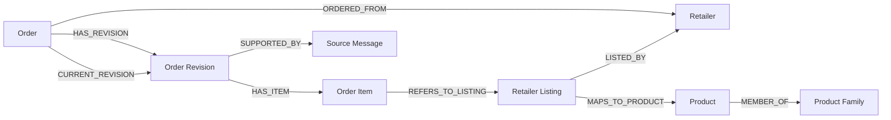

# Shopping knowledge graph model

Date: 20 September 2026
Status: Model decisions accepted in ticket 20; application implementation pending.
Decision record: [Define the shopping knowledge graph model](../issues/20-define-shopping-knowledge-graph-model.md)
Evidence: [actual-data and schema investigation](../research/shopping-knowledge-graph-model.md)

## Purpose and scope

Structure the existing purchase records as a knowledge graph that supports item
and Product Family purchase frequency, and later estimates of the next Purchase
Date. Product Family belongs in the initial scope. SQLite remains authoritative;
graph exports and calculated timelines are derived and rebuildable.

This specification consolidates the operator's accepted model decisions. The
first implementation deliverable is family/membership persistence and review,
a deterministic graph projection, an interactive Graph page in the existing app,
and an inspectable family purchase timeline. The Graph UI was explicitly added
by the operator after accepting the model; its addition does not change the model.
Prediction formulas, forecast eligibility thresholds, alerts, additional Chat
tools, and deployment are separate work.

## Entities and relationships

| Entity | Meaning |
| --- | --- |
| Order | A retailer's logical order, independent of how many messages or revisions describe it |
| Order Revision | One append-only recorded version, including status, dates, amounts, and source-event chronology |
| Order Item | One line in one revision, preserving raw name, quantity/unit, prices, and listing reference |
| Retailer Listing | A retailer-specific identity, separate from the exact Product it currently maps to |
| Product | An exact variant/package; its existing identity may still be provisional |
| Product Family | A defined product-type grouping across brands and package sizes, preserving member Products |
| Retailer | Seller identity, shared by its Orders and Listings |
| Source Message | Evidence for recorded facts; several messages may support one revision |

Use existing authoritative row identities for implemented entities. Keep graph
IDs stable across rebuilds of the same database, namespaced by dataset and entity
type; do not promise identical IDs after independent reimport into a new database.
Every edge has valid typed endpoints and supporting row/assertion references.
The current-revision edge represents the existing current selection, not another
purchase. Preserve all revision-source associations, not only the first email.

Different sizes/variants remain distinct Products even inside one Family. Similar
names do not justify exact-product merging. Brand, Category, aliases, and category
hierarchies are optional enrichment, with their own evidence; they are not needed
to establish the initial Family model.

## Product Family meaning and review

Families group the same product type across brands and sizes. Materially different
types stay separate: dairy milk and oat milk are illustrative separate families.
Each Family has a stable identity, a display name, and explicit inclusion/exclusion
criteria. Ambiguous variants are decided during membership review against those
criteria, not silently classified by a name prefix or broad category.

Suggestions are reviewed before participating in family frequency. A membership
is a separate assertion linking Product and Family; preserve its identity, origin,
review decision, rationale/support, and change history. Review acceptance does not
change an inferred suggestion's origin. An email proves a purchase, not the family
classification. Manual assignment is an operator assertion.

Only the current accepted assertion for a Product/Family pair participates in the
current graph/timeline. Pending and rejected suggestions remain outside the active
family view. A later withdrawal/correction supersedes the previous decision while
preserving its history. Duplicate suggestions or reviews cannot multiply active
membership edges. Unassigned Products retain their exact-product history and are
visible as unassigned. No automatic transitive family membership is implied.

Evaluate each Family independently. If explicit accepted memberships overlap,
never sum family counts as if they were disjoint household purchases. Membership
does not assert universal substitutability, equivalent consumption, or nutrition.

Family records and membership decisions belong in authoritative SQLite records,
added through a new numbered migration. They must not exist only in graph JSON.
Current family analysis applies the selected accepted membership snapshot to
eligible historical purchases. Record that snapshot/version so a later correction
can rebuild the current result without rewriting historical Items or claiming an
older result used today's membership. Existing listing-to-Product mappings are
not versioned; record the interpretation used rather than inventing old mappings.

## Purchase dates and eligibility

Purchase Date is the delivery date, converted to an `Asia/Singapore` calendar date
for day intervals. Stored timestamps stay UTC. The current parser's `delivery_at`
describes the beginning of a scheduled delivery slot, not confirmed arrival.
Order-placement, source-message, wrapper receipt, import, and graph-build times
remain distinct. Unknown delivery dates remain unknown; no email/order fallback.

The historical frequency view uses each Order's current revision when its status
is `placed` or `completed` and its Purchase Date is known and on or before the
analysis date. Exclude `cancelled`, `refunded`, and `unknown` from that analytic
view. Keep every recorded status and prior revision in the factual/history graph.
Show future scheduled purchases separately as upcoming; they are not elapsed
purchase intervals. A past scheduled date does not certify fulfillment.

## Counting and quantities

1. Preserve every Item line and its quantity, unit, price, and evidence.
2. For Product history, count once per Product per logical Order. Repeated lines,
   revisions, and forwarded wrappers do not create additional purchase occasions.
3. For Family history, union all qualifying member Products in each logical Order.
   Two family members in one order produce one family occurrence, while retaining
   both product histories and all contributing lines.
4. For day-gap calculations, use distinct Singapore Purchase Dates. Two Orders on
   one date remain two orders but provide one purchase day. Report order count,
   purchase-day count, dates/gaps, and quantities separately.
5. Keep quantity details by exact Product unless validated conversions establish
   compatible package/unit measures. Name parsing alone cannot justify family
   litres, kilograms, depletion, or multipack arithmetic.

Each derived occurrence links to its contributing Orders, selected Revisions,
Items, Products, Sources, and family membership assertions. A Purchase Date or
occurrence may be represented as a calculated record; it need not become a new
authoritative factual graph node.

## Projection and evidence contract

The default graph shows current recorded order facts and active accepted family
memberships. A history view preserves prior revisions, Items, and membership
decisions. The eligibility filter belongs to the frequency view, not a destructive
filter over factual records. Do not use the existing completed-only,
date-fallback `purchase_history` view unchanged for this purpose.

Take a consistent SQLite source snapshot, release database connections before
external work, and record source/membership snapshot identity, projection schema
and method versions, view/status policy, timezone, analysis date, and build time.
Stable sorting makes the same source/rules produce the same graph payload; build
metadata is separate. Validate complete output before replacing a prior export.

Private graph artifacts stay under ignored `data/`, `knowledge/`, or `graphify-out/`
paths with existing restrictive permissions. Source nodes expose local evidence
references, not raw email bodies, addresses, subjects, archive paths, credentials,
or authentication assertions absent from the data. All amounts stay integer cents
with currency. This model needs no additional database engine, vector index, RAG,
BM25, or LLM to compute dates, occurrences, and gaps.

## Actual-data limitations to preserve

The audited database contains 15 Orders, 110 Item lines, and 41 provisional
Products/Listings. All 15 orders are `placed` with a delivery date; no family
memberships exist yet. Two archived orders are absent from parsed history. Twenty
Products have at least two observed delivery days and seven have at least five;
these are Product counts, not Family counts or forecast-accuracy claims.

Report missing dates, unassigned products, provisional identities, and known
coverage gaps with later analyses. Unknown household shopping outside the archive
is not measurable from these records. The only two populated package quantities
match fit-weight ranges in names rather than verified package mass; do not use
them for normalized family quantities. Fixing ingestion or those fields is
separate work, not part of accepting this model.

## Graph explorer UI

The operator's ticket 23 follow-up adds purchase frequency to Product circle size
and direct dated Order neighborhoods on Product activation. `PURCHASED_IN` is a
rebuildable convenience relationship over qualifying current Product/Order
occurrences, supported by the actual current Revision and an Item from that
Product. It does not replace the detailed Item/Listing/Revision evidence chain or
add authoritative facts. Multiple Item lines in an Order yield one such edge.
Counts use the complete selected scope, independently of the visible graph page.
Older logical Orders remain included without enabling earlier revision versions.
Cancelled, unknown-date and upcoming records retain their existing factual paths
and coverage reporting; they do not contribute to this frequency view.

Provide **Graph** at `/graph` in the existing FastHTML/Stitchyard sidebar and shell.
The graph, family membership review, and purchase timeline are required UI outcomes
for the first implementation. Keep business labels and evidence understandable;
technical provenance is available on inspection rather than filling the overview.

The desktop page has a search/filter toolbar, a graph area, and a selected-node
details panel. On small screens the details/timeline stack below or open in an
accessible panel. Use the existing themes and responsive components.

- Begin with Families and Products, including clearly unassigned Products before
  any memberships are accepted. Search finds family/product labels. A type legend
  and labels/icons complement color; connected relationships have readable meanings.
- Support pan/zoom, fit/reset, select, and bounded expansion/collapse. A selected
  Product can reveal its Listing/Item/Revision/Order evidence path and Retailer/
  Source connections. The overview does not need to show every evidence node.
- Display a Family's definition, accepted members, distinct order/day counts, and
  a delivery-date timeline with gaps and quantities by Product. Link Products and
  Orders to the existing detail pages. Graph data and the timeline use the same
  selected source/membership interpretation. Show provisional identity and
  membership origin/review state, distinguishing recorded facts, reviewed grouping
  assertions, and calculated counts.
- Date-range filters use Singapore Purchase Dates and scope purchase activity and
  timeline metrics together. Retain membership/classification facts and state the
  selected period. Zero matching activity is not proof that a Product is unassigned.
  Make current/history mode, upcoming/unknown dates, and analytic status exclusions
  distinguishable. Node-type filters change graph presentation, not eligible
  timeline purchases. Graph subset counts are not complete-history totals.
- Put proposed memberships and their rationale in a separate review area with
  explicit accept/reject/withdraw controls. Pending suggestions are not active
  family edges. Selecting, dragging, or laying out nodes changes presentation only.
  Membership writes preserve review history and existing web protections.
- First-run setup provides **Create Family** (name and inclusion/exclusion
  definition) and **Propose membership** (existing Products, rationale, and origin).
  Proposals enter the pending queue and require a separate acceptance decision.
  Prepared operator/agent suggestions follow this same path; automatic
  classification is not a prerequisite for an operational review workflow.
- Provide a keyboard-accessible relationship list with the same selection/details
  as the graph. Support touch controls, focus management, and mobile sizing.
- Show honest loading, empty, unassigned, missing-node, and failed-expansion states.
  Keep the last valid view after failed/stale requests. Navigation, direct links,
  history restoration, and repeated page visits must not create duplicate handlers
  or apply stale responses to a new selection.

Enforce node/edge/expansion bounds on the server and show truncation/continuation
when applicable, without dangling displayed edges. Serve
assets and graph data locally; the renderer consumes application-owned graph
records, not raw emails or an external graph service. Escape stored text and expose
only safe source evidence metadata. Graphify remains an optional later experiment,
not a prerequisite for this page. Choose a minimal pinned renderer during the
implementation plan without changing SQLite authority or the accepted graph model.

## First deliverable and acceptance

Implement a persisted, reviewable family/membership foundation, a deterministic
projection, an interactive Graph page with membership review, and an inspectable
family timeline showing member Products, orders,
purchase days, gaps, quantities by Product, and evidence. Validate with synthetic
edge cases and the authorized actual records. Do not activate real suggested
memberships until the operator reviews the concrete assignments.

Acceptance scenarios:

- Different brands/sizes accepted into a Family preserve separate Products.
- Two members in one Order yield one family occurrence; two Orders on one
  Singapore day yield two orders and one purchase day.
- Duplicate lines, old revisions, and alternate wrappers preserve facts/evidence
  without inflating occurrences.
- Pending/rejected memberships affect no family timeline; accepting or withdrawing
  one changes the current derived timeline with an explainable mapping snapshot.
- A current cancellation leaves factual history intact and removes that Order
  from frequency; future/unknown-date records are handled explicitly.
- UTC-to-Singapore midnight boundaries use the correct calendar day without fallback.
- Unassigned Products remain visible, and unknown package conversions never produce
  invented family quantity totals.
- The same source snapshot and rules reproduce the graph, with all endpoints and
  factual/assertion references valid.
- An operator can search/select a Family or Product, expand its graph connections,
  inspect the matching timeline/evidence, and review a membership through the UI.
- Starting with no Families or proposals, an operator can create a Family, propose
  existing Products, and review that proposal into the first active family view.
  Retries are idempotent and conflicting stale reviews preserve the newer decision.
- Date/type filters, partial graph loading, and review changes keep displayed scope
  and counts truthful. Pending/rejected memberships never masquerade as active facts.
- Desktop/mobile and keyboard/list flows work across direct load, app navigation,
  back/forward, repeated visits, and failed/stale requests; source content stays
  protected and all displayed text is escaped.

Forecast method, minimum history threshold, uncertainty calibration, alerts, and
automatic suggestion machinery are later implementation decisions. Predictions,
when built, are separate derived estimates linked to their Product or Family and
supporting history; they never become fictional future Orders.
