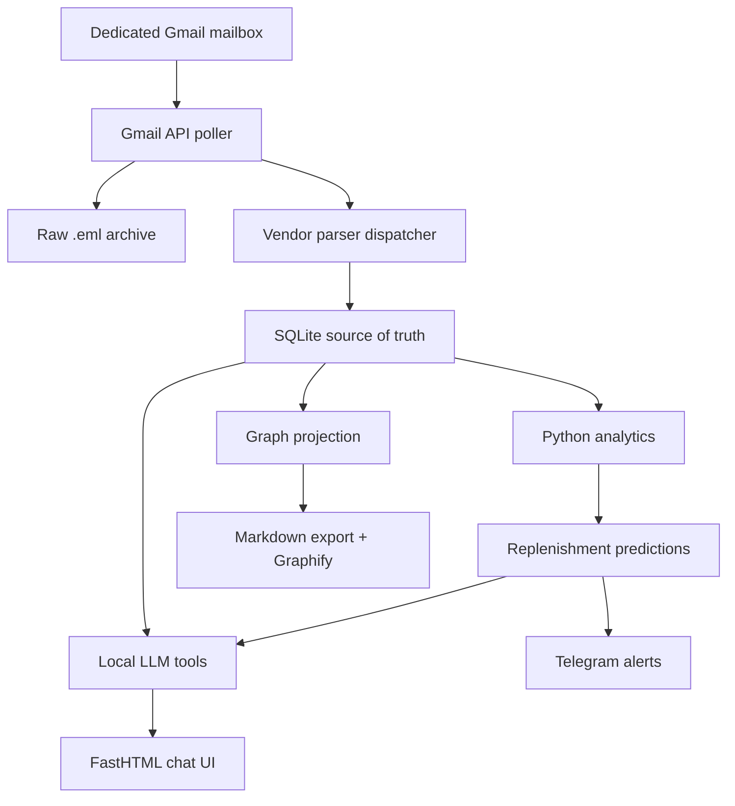

# Local Shopping Intelligence — MVP Plan

Status: ingestion, Chat and graph foundation implemented locally; host verification and later analytics remain pending
Target host: Ubuntu, i5-3570K, 16 GB RAM, RTX 3060 12 GB  
Primary user: one household/user  
Initial data source: one frequently used online grocery retailer

## 1. Current priority and earlier MVP scope

The operator clarified that the original goal is a shopping knowledge graph
and requested data modeling before building more tools. Tickets 20–21 settled and
implemented entities, relationships, identity, temporal views, and evidence using
the SQLite schema and authorized inspection of the actual data. The requested
graph redesign and subsequent Chat repairs in ticket 22 are now complete locally.
The first intended use is item purchase frequency and future purchase predictions.
The operator has accepted delivery date as Purchase Date for this analysis; the
current parser records the start of a scheduled slot, not confirmed arrival.
Unknown delivery dates stay unknown rather than falling back to order/email dates.
Product Family is now part of the accepted initial model, above exact Products:
group the same product type across brands/sizes, keep materially different types
separate, and review suggested memberships before they affect frequency.
The operator accepted current
`placed`/`completed` dated orders up to the analysis date, excluding cancelled,
refunded, unknown, and future scheduled records from historical frequency. Preserve
all lines, count one Product occurrence per Order, and use distinct Singapore
delivery days for intervals. A Family will need the union of its members' qualifying
occurrences, retaining exact-product details. The
[graph-model investigation](../.scratch/shopping-assistant/research/shopping-knowledge-graph-model.md)
and [decision ticket](../.scratch/shopping-assistant/issues/20-define-shopping-knowledge-graph-model.md)
record these accepted model decisions. The
[model specification](../.scratch/shopping-assistant/specs/shopping-knowledge-graph-model.md)
consolidates them; [ticket 21](../.scratch/shopping-assistant/issues/21-build-product-family-foundation.md)
is the first implementation deliverable. The operator also requested an interactive
Graph UI in the existing app, making visualization, family review, and purchase
timelines implemented web outcomes for that ticket. The
[implementation plan](../.scratch/shopping-assistant/plans/product-family-graph-explorer.md)
specifies family review persistence and bounded consistent graph reads. The
[UI redesign](../.scratch/shopping-assistant/plans/graph-ui-redesign.md) supersedes its
renderer choice with locally bundled Cytoscape. Synthetic browser verification covers the shell, family review,
selection, race handling, history, responsive layouts, and light/dark themes.
The operator authorized direct migration of the development database to schema 3;
a verified backup was retained and purchase facts are unchanged. No deployment was performed. SQLite remains
authoritative; graph and Markdown artifacts remain derived and rebuildable.

### Earlier Chat milestone — implemented locally, host verification remains separate

The selected Chat MVP is an Ollama-only Shopping Assistant with durable conversations,
streaming, Stop, retry and reconnect, using one Python agent loop. Five bounded
read tools are implemented: `search_products`, `get_product_history`,
`list_recent_orders`, `get_order`, and `list_purchase_items`. They read current
receipt records; the extracted delivery date is Purchase Date by operator convention.
Monthly listing retains individual repeated lines and all current statuses, distinct
from the Graph's qualifying frequency scope. The dedicated Chat page and these
repairs require separate host verification before they are called deployed.

The operator accepted all four decisions in
[Define Chat remediation scope and acceptance](../.scratch/shopping-assistant/issues/19-define-chat-remediation-scope-and-acceptance.md).
Repair the Stop/tool-result race and marker-only completion faults first, then
Conversation switching, ordinary replies/fallback correctness, and monthly retrieval.
The [reconciled remediation plan](../.scratch/shopping-assistant/plans/chat-reliability-and-answer-quality.md)
preserves runtime limits and requires factual/recovery checks, real-model/browser
verification, and private operator acceptance.
[Ticket 22](../.scratch/shopping-assistant/issues/22-implement-chat-remediation.md)
records completed local implementation and verification after ticket 21. Ticket 19 remains the
resolved decision record; the execution ticket records measured results and limits.

The operator reports that the deployment pipeline and Tailscale-hosted page already work. Reuse that baseline; verify actual inference during incremental chatbot implementation. The selected model is installed Qwen3.5 9B with thinking disabled, not a measured accuracy or GPU-fit guarantee. Cloud providers and agent-orchestration-library comparisons are deferred from this MVP. Wayfinder planning is complete; the [Chat MVP implementation plan](../.scratch/shopping-assistant/plans/chat-mvp.md) and tickets 14–18 define the work. Deploy checked working increments frequently to the experimental homelab, preserving the existing CI, backup and rollback path; do not wait for the whole Chat feature. Tickets 14–17 now have local implementations: bounded purchase-history tools, product evidence pages, the native Qwen backend, saved Conversation lifecycle operations, and the protected streaming Chat UI with reconnect and draft recovery. A synthetic local-loop/homelab-model check passed; deployment and host verification of the protected UI remain pending.

The graph model and ticket 22's Chat repairs are now implemented locally. The broader roadmap's replenishment predictions, shopping-list writes, and Telegram alerts remain later work. The UI redesign selected locally bundled Cytoscape; forecast algorithms remain separate decisions. Durable purchases remain searchable without generating inappropriate replenishment alerts.

The LLM is not the database and is not the forecasting engine. SQLite is authoritative; Python calculates predictions; the LLM selects tools and explains their results.

Implementation as of 21 September 2026 (Singapore): the Python 3.14 project, migration runner,
ingestion schema, exact-byte archive, deterministic parser, current-order pages,
health endpoint, local Ollama assistant, saved Conversations, protected Chat UI,
Product Family persistence/review, protected Cytoscape Graph page, monthly item
reads with saved pagination, accepted Chat repairs, and local test
suite work against sanitised fixtures. Graph supports current/history projections,
selected delivery timelines, and explicit membership review; it does not forecast,
auto-assign memberships, or add Chat tools. The authorized development database is migrated to schema 3; all purchase facts
match the pre-migration backup. The Ubuntu bootstrap and in-place deployment helper remain
unverified on the homelab. Gmail authorization/client/sync code exists, while
automatic scheduled ingestion, analytics, Telegram, and off-machine backup remain
planned or unverified.



## 2. Fixed technology choices

| Concern | MVP choice | Reason |
|---|---|---|
| Runtime | Python 3.14 managed by `uv` | Matches the repository configuration and keeps setup reproducible. |
| Environments | `development` on the MacBook and in isolated automated checks; `production` on Ubuntu | Two profiles match the actual workflow without a separate staging or test configuration. |
| Model server | Ollama | Separate, local model process with streaming and tool calling. |
| Main model | `qwen3.5:9b`, thinking disabled | Operator-selected installed model; validate actual tool behavior and GPU fit during integration. |
| Model comparison | Not required before implementation | Revisit selection only after a concrete compatibility, correctness, memory, or latency problem. |
| Model context | 8,192 tokens initially | Starting evaluation target, including output/headroom; validate full GPU residency and try 4,096 if needed. |
| Database | SQLite, using WAL only on a patched runtime | Simple, inspectable, local, and appropriate for fewer than five users with brief writes. |
| Database access | Python `sqlite3` plus versioned SQL migrations | Keeps the schema and SQL visible while learning; no ORM is required. |
| Validation | Pydantic v2 | Strict boundaries for parser, tool, and API inputs/outputs. |
| UI | FastHTML + HTMX | Server-rendered interface with minimal JavaScript. |
| Chat transport | FastHTML WebSocket | One connection supports prompts, token streaming, tool status, and final answers. |
| Programmatic API | FastAPI mounted at `/api` | Useful for health, import, order, prediction, and future mobile endpoints. |
| Email access | Gmail API with OAuth and `gmail.readonly` | Least-privilege mailbox access; local Gmail message IDs provide idempotency. |
| Scheduling | Two `systemd` timers | No Redis or job broker: frequent ingestion and one daily prediction/alert run. |
| Deployment | Native `uv` environment + `systemd` | Reproducible Mac-to-Ubuntu releases without container or GPU-runtime complexity. |
| CI/CD | GitHub-hosted CI + manual SSH deployment | Public-repository validation stays on disposable hosted runners; no repository workflow executes inside the homelab. |
| Notification | Telegram Bot API | Straightforward HTTP API and reliable personal push notifications. |
| Remote UI | Tailscale Serve to a localhost-bound app | Phone access without making the service public. |
| Graph operations | SQLite graph projection + NetworkX when traversal is needed | Exact application-owned nodes and edges remain queryable independent of Graphify. |
| Graphify | Scan generated Markdown and expose its `graph.html` as an experiment | Included for learning/visualization, not used as the operational database. |

### Why SQLite is appropriate

The expected limit is fewer than five concurrent **users**, not five permanently open database connections. A browser can keep a chat WebSocket open without keeping a SQLite transaction or connection open. Database concurrency is determined by overlapping transactions—especially overlapping writes—not by the number of connected browsers.

This application's workload is SQLite-friendly:

- Chat questions, dashboards, history, predictions, and graph exploration are predominantly reads.
- Writes such as saving one chat message, adding a shopping-list item, or recording a tool call are small and normally complete in milliseconds.
- Email ingestion is periodic rather than a continuous write stream.
- All processes and the database file run on the same Ubuntu machine; the SQLite file is never placed on a network filesystem.
- The application is single-instance and the expected database is far below SQLite's practical size limits.

On a patched runtime, SQLite WAL mode allows readers and a writer to operate at the same time, although SQLite still permits only one writer at an instant. That limitation is acceptable here because short writes can queue briefly. An affected development SQLite build is forced into the rollback journal, and health remains not ready; production refuses to start until the runtime is patched. SQLite avoids a separate database server, credentials, ports, upgrades, and backup procedures while keeping the data inspectable and portable.

The application must verify and expose both `sys.version` and `sqlite3.sqlite_version` through `/api/health`. Because multiple local processes will use WAL, deployment requires a SQLite build containing the WAL-reset corruption fix: SQLite 3.51.3 or newer, or a fixed backport such as 3.50.7 or 3.44.6. Startup must fail with a clear diagnostic when the runtime SQLite build is known to be affected.

Operating rules for reliable concurrency:

1. Open a connection for a database operation and return/close it promptly; never reserve one connection for the lifetime of a WebSocket.
2. Initialize every connection with `foreign_keys=ON` and `busy_timeout=5000`; select WAL only when the runtime contains the required fix, otherwise select the rollback journal for development.
3. Never hold a transaction while waiting for Ollama, Gmail, Graphify, Telegram, or user input.
4. Parse email and generate LLM output outside a transaction, then perform the final database changes in one short transaction.
5. Run one Uvicorn application worker initially. Its async server can handle the small number of browser/WebSocket users; synchronous repository work is dispatched without blocking the event loop.
6. Keep scheduled recomputation transactions bounded. Large calculations read into memory first and persist results in a short transaction.
7. Treat `database is locked` after the configured wait as an observable error. The Shopping Assistant does not automatically replay a failed operation; preserve the incomplete attempt and offer explicit Retry. The bounded SQLite busy wait is not an application retry.
8. Create each `sqlite3` connection inside the thread that uses it; never pass a default connection between request/worker threads.
9. Back up a live database with Python's SQLite backup API, never by copying only `shopping.sqlite3` while WAL mode is active.

The initial operating envelope is:

| Dimension | MVP assumption |
|---|---|
| Concurrent users | Fewer than 5 |
| Open chat WebSockets | Fewer than 5 |
| Simultaneous writers | Normally 0–1; occasional brief contention |
| Application instances | 1 |
| Database location | Local SSD on the Ubuntu host |
| Long-running transactions | None |

Move to PostgreSQL when there is measured evidence of sustained concurrent writes, recurring lock timeouts despite short transactions, multiple application instances/hosts, or a requirement for clients to access the database directly over a network. The repository/service boundary and versioned migrations are intentionally designed to make that later migration contained.

The fewer-than-five-user assumption means trusted browser/device sessions sharing one household dataset. It does not provide per-person ownership or privacy. Add `users`, `households`, membership, and row ownership before supporting separate untrusted accounts.

Do not add LangChain, LlamaIndex, a vector database, Redis, Celery, Neo4j, or Docker to the MVP. Each can be evaluated later against a demonstrated need.

### Ollama runtime settings

Ticket 15 implements the native asynchronous adapter, single-slot Python loop and
whole-exchange context budget locally. Ollama 0.30.10 render-only prompts plus the
installed Qwen35 BPE metadata provide exact model-aware input counts; unknown
versions and count mismatches fail closed. No inference is performed by core health.
The helper preparation must precede expanded host configuration. See the deployment
guide for measured synthetic acceptance and remaining service-context checks.

The accepted [operations plan](../.scratch/shopping-assistant/issues/12-define-provider-operations.md)
selects the actually installed `qwen3.5:9b` with thinking disabled as the MVP default.
No Gemma comparison or repeated model benchmark is required before implementation.
Reuse Ollama 0.30.10 initially; do not download or upgrade automatically. Load the
model on demand with five-minute keep-alive; keep core app health independent of
assistant availability and validate actual model/tool behavior before rollout.

Start with one loaded model and one request at a time. The model below is the
operator's selected default, not a measured GPU-fit or accuracy guarantee.
The accepted runtime limits are recorded in section 6; actual inference still
requires a small integration check during implementation acceptance.

```text
model: qwen3.5:9b
think: false
num_ctx: 8192
num_predict: 768
temperature for tool routing: 0.1
temperature for ambiguous normalization: 0.0
OLLAMA_NUM_PARALLEL: 1
OLLAMA_MAX_LOADED_MODELS: 1
```

Use `ollama ps` during acceptance testing. The target is `100% GPU`. If 8K context causes offload or instability, try the accepted 4K setting before changing the model. Investigate concrete failures before considering an alternative; do not automatically switch models, download replacements, or enlarge the accepted budgets.

The operator selected Qwen3.5 9B after reviewing the [local model research](../.scratch/shopping-assistant/research/local-model-selection.md), prioritizing progress over further model comparisons. Existing other models can remain installed but are not loaded for an MVP comparison. Published benchmarks are supporting evidence, not proof of this application's behavior on the host.

Use deterministic parsing before the LLM. The model should only resolve ambiguous product identity/category mappings and turn tool results into natural language.

## 3. Gmail design

Create an ordinary dedicated Gmail mailbox, for example `my.shopping.inbox@...`. This is not a Google Cloud service account. A Cloud service account cannot directly read a consumer Gmail user's mailbox; impersonation requires a managed Google Workspace domain and administrator-granted domain-wide delegation.

Recommended flow:

1. Automatically forward messages from supported retailers from the personal mailbox to the dedicated mailbox using narrow Gmail filters.
2. Backfill old transactions. Preserve them as `.eml` attachments when possible; the parser must also support ordinary inline forwarded messages.
3. Authorize the Ubuntu application once through the Gmail OAuth desktop flow.
4. Store the resulting refresh token outside Git with owner-only file permissions.
5. Poll every five minutes with a Gmail search query restricted by known sender/subject patterns, following every `nextPageToken` until exhausted.
6. Persist a Gmail history cursor when available. Also retain a timestamp watermark and overlap window so a full-search fallback safely rechecks recent messages.
7. Fetch each candidate in RAW format and derive both an outer Gmail ID and an inner/original-message or transaction fingerprint.
8. Authenticate the configured forwarding provenance using Gmail metadata and preserved authentication/ARC evidence where available. An inner `From` header alone is never authentication; unverifiable automatic messages enter review.
9. Archive the decoded RFC 2822 message before parsing using temporary file → `fsync` → atomic rename.
10. Deduplicate by Gmail message ID, original-content fingerprint, and finally `(retailer, external_order_id, revision fingerprint)`.
11. Classify retries separately for rate limiting, temporary Gmail failure, revoked/expired OAuth, malformed MIME, unverified provenance, and unsupported retailer layout.
12. Reconcile the raw archive and database periodically so a crash between file and database operations can be repaired in either direction.

The initial OAuth scope is `https://www.googleapis.com/auth/gmail.readonly`. Because processing state is kept locally, the app does not need permission to modify Gmail labels. If mailbox labels become operationally useful later, explicitly migrate to `gmail.modify`.

Raw files live under this untracked structure:

```text
data/
├── shopping.sqlite3
└── raw-email/
    ├── manual/<sha256-prefix>/<sha256>.eml
    └── gmail/<sha256-prefix>/<sha256>.eml    # planned
```

The raw message is the audit record. Re-running a newer parser against the same raw input must be possible without accessing Gmail again. Health output includes the last successful poll, cursor/watermark, messages scanned, messages imported, and current OAuth status. OAuth authorization is configured for production use where applicable; testing-mode token expiry must be detected and surfaced.

### Private-data policy

- Run the application under a dedicated unprivileged Unix account.
- Use `0700` for private data directories and `0600` for raw email, databases, OAuth credentials, and backups.
- Do not render archived retailer HTML directly. Parse it as untrusted input, strip scripts/event handlers, and never load remote images or tracking URLs.
- Do not persist a separate extracted HTML copy unless a parser fixture or debugging case requires it; the raw `.eml` remains authoritative.
- Keep backups encrypted, define retention, and test restore. Use the SQLite backup API for the database and an encrypted file backup for raw email.
- Load Gmail and Telegram secrets with systemd credentials or equivalently restricted files, not committed `.env` files.
- Telegram is an external disclosure channel. Alerts contain only the minimum product/due information and never names, addresses, order IDs, or tracking links.

## 4. Exact target SQLite schema

This is the cumulative target schema. It is delivered through staged migrations rather than as one oversized initial migration.

Conventions:

- Money is stored as integer cents, never floating-point dollars.
- Timestamps are UTC ISO-8601 text; the UI displays Asia/Singapore time.
- `ordered_at` remains null when a retailer email proves only its own sent time; the
  source event timestamp is retained separately and is never relabelled as an order fact.
- Charged tax and informational tax already included in the total are stored separately;
  miscellaneous positive fees are not folded into a named service fee.
- IDs are SQLite integer primary keys except stable graph node/edge identifiers.
- JSON columns contain valid JSON text and are checked by SQLite as well as validated at the Python boundary.
- `EXTRACTED` means directly present in source email, `DERIVED` means deterministic Python output, `INFERRED` means an LLM conclusion, and `MANUAL` means user-confirmed knowledge.

```sql
PRAGMA foreign_keys = ON;
PRAGMA journal_mode = WAL;
PRAGMA busy_timeout = 5000;

CREATE TABLE schema_migrations (
    version       INTEGER PRIMARY KEY,
    name          TEXT NOT NULL,
    checksum      TEXT NOT NULL,
    started_at    TEXT NOT NULL,
    applied_at    TEXT,
    is_dirty      INTEGER NOT NULL DEFAULT 1 CHECK (is_dirty IN (0,1)),
    CHECK ((is_dirty = 1 AND applied_at IS NULL) OR
           (is_dirty = 0 AND applied_at IS NOT NULL))
) STRICT;

CREATE TABLE email_sync_state (
    account_key          TEXT PRIMARY KEY,
    gmail_history_id     TEXT,
    scan_watermark_at    TEXT NOT NULL,
    overlap_seconds      INTEGER NOT NULL DEFAULT 86400 CHECK (overlap_seconds >= 0),
    last_success_at      TEXT,
    last_error_at        TEXT,
    last_error           TEXT,
    updated_at           TEXT NOT NULL
) STRICT, WITHOUT ROWID;

CREATE TABLE email_messages (
    id                   INTEGER PRIMARY KEY,
    source_kind          TEXT NOT NULL CHECK (source_kind IN ('manual','gmail')),
    source_message_key   TEXT NOT NULL UNIQUE,
    gmail_message_id     TEXT,
    gmail_thread_id      TEXT,
    rfc822_message_id    TEXT,
    original_message_id  TEXT,
    source_fingerprint   TEXT NOT NULL,
    sender               TEXT NOT NULL,
    recipient            TEXT,
    subject              TEXT NOT NULL,
    received_at          TEXT NOT NULL,
    gmail_internal_at    TEXT,
    source_sent_at       TEXT,
    raw_sha256           TEXT NOT NULL UNIQUE,
    raw_path             TEXT NOT NULL UNIQUE,
    parse_status         TEXT NOT NULL DEFAULT 'pending'
                         CHECK (parse_status IN ('pending','parsed','ignored','failed','needs_review')),
    parser_version       TEXT,
    parse_error          TEXT,
    fetched_at           TEXT NOT NULL,
    parsed_at            TEXT
) STRICT;

CREATE UNIQUE INDEX idx_email_gmail_message_id
    ON email_messages(gmail_message_id) WHERE gmail_message_id IS NOT NULL;
CREATE INDEX idx_email_status_date
    ON email_messages(parse_status, received_at);
CREATE INDEX idx_email_original_message_id
    ON email_messages(original_message_id);
CREATE INDEX idx_email_source_fingerprint
    ON email_messages(source_fingerprint);

CREATE TABLE retailers (
    id          INTEGER PRIMARY KEY,
    slug        TEXT NOT NULL UNIQUE,
    name        TEXT NOT NULL,
    country     TEXT NOT NULL,
    created_at  TEXT NOT NULL
) STRICT;

CREATE TABLE brands (
    id               INTEGER PRIMARY KEY,
    canonical_name   TEXT NOT NULL,
    normalized_name  TEXT NOT NULL UNIQUE,
    created_at       TEXT NOT NULL,
    updated_at       TEXT NOT NULL
) STRICT;

CREATE TABLE categories (
    id          INTEGER PRIMARY KEY,
    parent_id   INTEGER REFERENCES categories(id),
    slug        TEXT NOT NULL UNIQUE,
    name        TEXT NOT NULL,
    created_at  TEXT NOT NULL,
    CHECK (parent_id IS NULL OR parent_id <> id)
) STRICT;

CREATE TABLE products (
    id                INTEGER PRIMARY KEY,
    canonical_key     TEXT NOT NULL UNIQUE,
    canonical_name    TEXT NOT NULL,
    normalized_name   TEXT NOT NULL,
    brand_id          INTEGER REFERENCES brands(id),
    category_id       INTEGER REFERENCES categories(id),
    package_quantity  REAL CHECK (package_quantity IS NULL OR package_quantity > 0),
    package_unit      TEXT,
    variant           TEXT,
    is_active         INTEGER NOT NULL DEFAULT 1 CHECK (is_active IN (0,1)),
    created_at        TEXT NOT NULL,
    updated_at        TEXT NOT NULL
) STRICT;

CREATE INDEX idx_products_normalized_name
    ON products(normalized_name);
CREATE INDEX idx_products_category
    ON products(category_id);

CREATE TABLE retailer_products (
    id                 INTEGER PRIMARY KEY,
    retailer_id        INTEGER NOT NULL REFERENCES retailers(id),
    external_sku       TEXT,
    listing_key        TEXT NOT NULL,
    product_id         INTEGER NOT NULL REFERENCES products(id),
    latest_name        TEXT NOT NULL,
    latest_size_text   TEXT,
    match_status       TEXT NOT NULL DEFAULT 'provisional'
                       CHECK (match_status IN ('provisional','confirmed','rejected')),
    match_method       TEXT NOT NULL DEFAULT 'parser'
                       CHECK (match_method IN ('parser','rule','llm','manual')),
    match_confidence   REAL NOT NULL DEFAULT 1.0
                       CHECK (match_confidence >= 0.0 AND match_confidence <= 1.0),
    first_seen_at      TEXT NOT NULL,
    last_seen_at       TEXT NOT NULL,
    UNIQUE (retailer_id, listing_key)
) STRICT;

CREATE INDEX idx_retailer_products_product
    ON retailer_products(product_id);
CREATE UNIQUE INDEX idx_retailer_products_sku
    ON retailer_products(retailer_id, external_sku)
    WHERE external_sku IS NOT NULL;

CREATE TABLE product_aliases (
    id                INTEGER PRIMARY KEY,
    retailer_id       INTEGER REFERENCES retailers(id),
    normalized_alias  TEXT NOT NULL,
    display_alias     TEXT NOT NULL,
    product_id        INTEGER NOT NULL REFERENCES products(id),
    source_kind       TEXT NOT NULL
                      CHECK (source_kind IN ('EXTRACTED','INFERRED','MANUAL')),
    confidence        REAL NOT NULL
                      CHECK (confidence >= 0.0 AND confidence <= 1.0),
    review_status     TEXT NOT NULL DEFAULT 'unreviewed'
                      CHECK (review_status IN ('unreviewed','accepted','rejected')),
    created_at        TEXT NOT NULL
) STRICT;

CREATE UNIQUE INDEX idx_product_aliases_retailer
    ON product_aliases(retailer_id, normalized_alias)
    WHERE retailer_id IS NOT NULL;
CREATE UNIQUE INDEX idx_product_aliases_global
    ON product_aliases(normalized_alias)
    WHERE retailer_id IS NULL;

CREATE TABLE orders (
    id                 INTEGER PRIMARY KEY,
    retailer_id        INTEGER NOT NULL REFERENCES retailers(id),
    external_order_id  TEXT NOT NULL,
    created_at         TEXT NOT NULL,
    UNIQUE (retailer_id, external_order_id)
) STRICT;

CREATE TABLE order_revisions (
    id                 INTEGER PRIMARY KEY,
    order_id           INTEGER NOT NULL REFERENCES orders(id) ON DELETE CASCADE,
    email_message_id   INTEGER NOT NULL REFERENCES email_messages(id),
    revision_number    INTEGER NOT NULL CHECK (revision_number > 0),
    revision_kind      TEXT NOT NULL
                       CHECK (revision_kind IN ('confirmation','amendment','receipt','refund','reparse')),
    revision_fingerprint TEXT NOT NULL,
    parser_version     TEXT NOT NULL,
    source_event_at    TEXT NOT NULL,
    ordered_at         TEXT,
    delivery_at       TEXT,
    currency           TEXT NOT NULL,
    subtotal_cents     INTEGER CHECK (subtotal_cents IS NULL OR subtotal_cents >= 0),
    discount_cents     INTEGER NOT NULL DEFAULT 0 CHECK (discount_cents >= 0),
    delivery_fee_cents INTEGER NOT NULL DEFAULT 0 CHECK (delivery_fee_cents >= 0),
    service_fee_cents  INTEGER NOT NULL DEFAULT 0 CHECK (service_fee_cents >= 0),
    other_fee_cents    INTEGER NOT NULL DEFAULT 0 CHECK (other_fee_cents >= 0),
    tax_cents          INTEGER CHECK (tax_cents IS NULL OR tax_cents >= 0),
    included_tax_cents INTEGER NOT NULL DEFAULT 0 CHECK (included_tax_cents >= 0),
    total_cents        INTEGER NOT NULL CHECK (total_cents >= 0),
    status             TEXT NOT NULL DEFAULT 'completed'
                       CHECK (status IN ('placed','completed','cancelled','refunded','unknown')),
    is_current         INTEGER NOT NULL DEFAULT 1 CHECK (is_current IN (0,1)),
    created_at         TEXT NOT NULL,
    UNIQUE (order_id, revision_number),
    UNIQUE (order_id, revision_fingerprint)
) STRICT;

CREATE UNIQUE INDEX idx_order_revisions_current
    ON order_revisions(order_id) WHERE is_current = 1;
CREATE INDEX idx_order_revisions_ordered_at
    ON order_revisions(ordered_at);

CREATE TABLE order_revision_sources (
    order_revision_id INTEGER NOT NULL REFERENCES order_revisions(id) ON DELETE CASCADE,
    email_message_id  INTEGER NOT NULL REFERENCES email_messages(id) ON DELETE CASCADE,
    linked_at         TEXT NOT NULL,
    PRIMARY KEY (order_revision_id, email_message_id)
) STRICT, WITHOUT ROWID;

CREATE TABLE order_items (
    id                    INTEGER PRIMARY KEY,
    order_revision_id     INTEGER NOT NULL REFERENCES order_revisions(id) ON DELETE CASCADE,
    line_number           INTEGER NOT NULL CHECK (line_number > 0),
    line_fingerprint      TEXT NOT NULL,
    retailer_product_id   INTEGER NOT NULL REFERENCES retailer_products(id),
    raw_name              TEXT NOT NULL,
    quantity              REAL NOT NULL CHECK (quantity > 0),
    unit                  TEXT NOT NULL DEFAULT 'item',
    unit_price_cents      INTEGER CHECK (unit_price_cents IS NULL OR unit_price_cents >= 0),
    gross_cents           INTEGER CHECK (gross_cents IS NULL OR gross_cents >= 0),
    discount_cents        INTEGER NOT NULL DEFAULT 0 CHECK (discount_cents >= 0),
    net_cents             INTEGER NOT NULL CHECK (net_cents >= 0),
    created_at            TEXT NOT NULL,
    UNIQUE (order_revision_id, line_number),
    UNIQUE (order_revision_id, line_fingerprint)
) STRICT;

CREATE INDEX idx_order_items_product
    ON order_items(retailer_product_id);

CREATE VIEW purchase_history AS
SELECT
    oi.id AS order_item_id,
    o.id AS order_id,
    rev.id AS order_revision_id,
    COALESCE(rev.delivery_at, rev.ordered_at, rev.source_event_at) AS purchase_event_at,
    rev.ordered_at,
    rev.delivery_at,
    o.external_order_id,
    r.slug AS retailer,
    p.id AS product_id,
    p.canonical_name,
    p.category_id,
    oi.quantity,
    oi.unit,
    oi.unit_price_cents,
    oi.net_cents
FROM order_items oi
JOIN order_revisions rev ON rev.id = oi.order_revision_id AND rev.is_current = 1
JOIN orders o ON o.id = rev.order_id
JOIN retailers r ON r.id = o.retailer_id
JOIN retailer_products rp ON rp.id = oi.retailer_product_id
JOIN products p ON p.id = rp.product_id
WHERE rev.status = 'completed';

CREATE TABLE product_metrics (
    product_id              INTEGER PRIMARY KEY REFERENCES products(id) ON DELETE CASCADE,
    purchase_count          INTEGER NOT NULL CHECK (purchase_count >= 0),
    first_purchased_at      TEXT NOT NULL,
    last_purchased_at       TEXT NOT NULL,
    median_interval_days    REAL CHECK (median_interval_days IS NULL OR median_interval_days > 0),
    interval_mad_days       REAL CHECK (interval_mad_days IS NULL OR interval_mad_days >= 0),
    mean_quantity           REAL CHECK (mean_quantity IS NULL OR mean_quantity > 0),
    median_unit_price_cents INTEGER CHECK (median_unit_price_cents IS NULL OR median_unit_price_cents >= 0),
    price_trend_pct         REAL,
    calculated_at           TEXT NOT NULL,
    algorithm_version       TEXT NOT NULL
) STRICT;

CREATE TABLE replenishment_cycles (
    id                          INTEGER PRIMARY KEY,
    product_id                  INTEGER NOT NULL REFERENCES products(id) ON DELETE CASCADE,
    last_purchase_order_item_id INTEGER NOT NULL REFERENCES order_items(id),
    algorithm_version           TEXT NOT NULL,
    cycle_key                   TEXT NOT NULL UNIQUE,
    status                      TEXT NOT NULL DEFAULT 'active'
                                CHECK (status IN ('active','resolved','dismissed','expired')),
    opened_at                   TEXT NOT NULL,
    resolved_at                 TEXT,
    CHECK ((status = 'active' AND resolved_at IS NULL) OR
           (status <> 'active' AND resolved_at IS NOT NULL)),
    UNIQUE (product_id, last_purchase_order_item_id, algorithm_version)
) STRICT;

CREATE TABLE replenishment_predictions (
    id                    INTEGER PRIMARY KEY,
    cycle_id              INTEGER NOT NULL REFERENCES replenishment_cycles(id) ON DELETE CASCADE,
    generated_at          TEXT NOT NULL,
    expected_at           TEXT NOT NULL,
    window_start_at       TEXT NOT NULL,
    window_end_at         TEXT NOT NULL,
    due_score             REAL NOT NULL CHECK (due_score >= 0.0 AND due_score <= 1.0),
    confidence            REAL NOT NULL CHECK (confidence >= 0.0 AND confidence <= 1.0),
    history_count         INTEGER NOT NULL CHECK (history_count >= 5),
    median_interval_days  REAL NOT NULL CHECK (median_interval_days > 0),
    interval_mad_days     REAL NOT NULL CHECK (interval_mad_days >= 0),
    algorithm_version     TEXT NOT NULL,
    evidence_json         TEXT NOT NULL DEFAULT '{}' CHECK (json_valid(evidence_json)),
    is_current            INTEGER NOT NULL DEFAULT 1 CHECK (is_current IN (0,1)),
    UNIQUE (cycle_id, generated_at)
) STRICT;

CREATE UNIQUE INDEX idx_predictions_current
    ON replenishment_predictions(cycle_id) WHERE is_current = 1;
CREATE INDEX idx_predictions_due
    ON replenishment_predictions(is_current, due_score, window_end_at);

CREATE TABLE co_purchase_edges (
    product_a_id    INTEGER NOT NULL REFERENCES products(id) ON DELETE CASCADE,
    product_b_id    INTEGER NOT NULL REFERENCES products(id) ON DELETE CASCADE,
    order_count     INTEGER NOT NULL CHECK (order_count >= 0),
    total_orders    INTEGER NOT NULL CHECK (total_orders > 0),
    support         REAL NOT NULL CHECK (support >= 0.0 AND support <= 1.0),
    confidence_ab   REAL NOT NULL CHECK (confidence_ab >= 0.0 AND confidence_ab <= 1.0),
    confidence_ba   REAL NOT NULL CHECK (confidence_ba >= 0.0 AND confidence_ba <= 1.0),
    lift            REAL NOT NULL CHECK (lift >= 0.0),
    calculated_at   TEXT NOT NULL,
    algorithm_version TEXT NOT NULL,
    CHECK (product_a_id < product_b_id),
    PRIMARY KEY (product_a_id, product_b_id, algorithm_version)
) STRICT, WITHOUT ROWID;

CREATE TABLE shopping_lists (
    id          INTEGER PRIMARY KEY,
    name        TEXT NOT NULL,
    status      TEXT NOT NULL DEFAULT 'open'
                CHECK (status IN ('open','completed','archived')),
    created_at  TEXT NOT NULL,
    completed_at TEXT
) STRICT;

CREATE UNIQUE INDEX idx_one_open_default_list
    ON shopping_lists(status) WHERE status = 'open';

CREATE TABLE shopping_list_items (
    id                    INTEGER PRIMARY KEY,
    shopping_list_id      INTEGER NOT NULL REFERENCES shopping_lists(id) ON DELETE CASCADE,
    product_id            INTEGER REFERENCES products(id),
    free_text             TEXT,
    desired_quantity      REAL NOT NULL DEFAULT 1 CHECK (desired_quantity > 0),
    desired_unit          TEXT NOT NULL DEFAULT 'item',
    reason_kind           TEXT NOT NULL DEFAULT 'manual'
                          CHECK (reason_kind IN ('manual','chat','prediction','forgotten_item')),
    prediction_id         INTEGER REFERENCES replenishment_predictions(id),
    status                TEXT NOT NULL DEFAULT 'needed'
                          CHECK (status IN ('needed','purchased','dismissed')),
    added_at              TEXT NOT NULL,
    purchased_at          TEXT,
    matched_order_item_id INTEGER REFERENCES order_items(id),
    CHECK ((product_id IS NOT NULL AND free_text IS NULL) OR
           (product_id IS NULL AND free_text IS NOT NULL)),
    CHECK ((status = 'purchased' AND purchased_at IS NOT NULL) OR status <> 'purchased')
) STRICT;

-- Keys outlive deletion to fence stale draft submissions, without retaining content.
CREATE TABLE conversation_keys (
    id TEXT PRIMARY KEY,
    consumed INTEGER NOT NULL DEFAULT 0 CHECK (consumed IN (0, 1))
) STRICT;

CREATE TABLE conversations (
    id TEXT PRIMARY KEY REFERENCES conversation_keys(id),
    title TEXT NOT NULL CHECK (length(title) BETWEEN 1 AND 80),
    endpoint TEXT NOT NULL,
    model TEXT NOT NULL,
    version INTEGER NOT NULL DEFAULT 1 CHECK (version > 0),
    deleting INTEGER NOT NULL DEFAULT 0 CHECK (deleting IN (0, 1)),
    created_at TEXT NOT NULL,
    activity_at TEXT NOT NULL
) STRICT;
CREATE INDEX idx_conversation_activity ON conversations(activity_at DESC, id DESC);

CREATE TABLE conversation_messages (
    id INTEGER PRIMARY KEY AUTOINCREMENT,
    conversation_id TEXT NOT NULL REFERENCES conversations(id) ON DELETE CASCADE,
    content TEXT NOT NULL CHECK (length(content) BETWEEN 1 AND 4000),
    created_at TEXT NOT NULL
) STRICT;
CREATE INDEX idx_conversation_messages ON conversation_messages(conversation_id, id);
CREATE TRIGGER immutable_submitted_message BEFORE UPDATE ON conversation_messages
BEGIN SELECT RAISE(ABORT, 'Submitted messages are immutable'); END;

CREATE TABLE response_attempts (
    id INTEGER PRIMARY KEY AUTOINCREMENT,
    message_id INTEGER NOT NULL REFERENCES conversation_messages(id) ON DELETE CASCADE,
    status TEXT NOT NULL DEFAULT 'running'
        CHECK (status IN ('running', 'stopping', 'complete', 'failed', 'stopped', 'interrupted')),
    version INTEGER NOT NULL DEFAULT 1 CHECK (version > 0),
    text TEXT NOT NULL DEFAULT '' CHECK (length(CAST(text AS BLOB)) <= 65536),
    code TEXT,
    evidence_json TEXT NOT NULL DEFAULT '[]' CHECK (json_valid(evidence_json)),
    created_at TEXT NOT NULL,
    updated_at TEXT NOT NULL
) STRICT;
CREATE INDEX idx_attempt_message ON response_attempts(message_id, id);
-- There is one application-wide response slot, including cancellation cleanup.
CREATE UNIQUE INDEX idx_one_active_response ON response_attempts((1))
    WHERE status IN ('running', 'stopping');

CREATE TABLE conversation_tools (
    attempt_id INTEGER NOT NULL REFERENCES response_attempts(id) ON DELETE CASCADE,
    call_id TEXT NOT NULL,
    position INTEGER NOT NULL CHECK (position BETWEEN 1 AND 8),
    name TEXT NOT NULL,
    arguments_json TEXT NOT NULL CHECK (json_valid(arguments_json)
        AND length(CAST(arguments_json AS BLOB)) <= 4096),
    result_json TEXT CHECK (result_json IS NULL OR (json_valid(result_json)
        AND length(CAST(result_json AS BLOB)) <= 4096)),
    PRIMARY KEY (attempt_id, call_id),
    UNIQUE (attempt_id, position)
) STRICT;

-- Only identifiers survive deletion. No message, title or tool content is kept here.
CREATE TABLE conversation_commands (
    id TEXT PRIMARY KEY,
    conversation_id TEXT NOT NULL REFERENCES conversation_keys(id),
    fingerprint TEXT,
    outcome_json TEXT NOT NULL CHECK (json_valid(outcome_json))
) STRICT;
CREATE INDEX idx_conversation_commands ON conversation_commands(conversation_id);

CREATE TABLE notification_channels (
    id                 INTEGER PRIMARY KEY,
    channel_type       TEXT NOT NULL CHECK (channel_type = 'telegram'),
    destination        TEXT NOT NULL,
    secret_credential_name TEXT NOT NULL,
    enabled            INTEGER NOT NULL DEFAULT 1 CHECK (enabled IN (0,1)),
    created_at         TEXT NOT NULL,
    UNIQUE (channel_type, destination)
) STRICT;

CREATE TABLE alerts (
    id              INTEGER PRIMARY KEY,
    alert_type      TEXT NOT NULL CHECK (alert_type IN ('due_soon','overdue','forgotten_item','price_change')),
    product_id      INTEGER REFERENCES products(id),
    prediction_id   INTEGER REFERENCES replenishment_predictions(id),
    dedupe_key      TEXT NOT NULL UNIQUE,
    title           TEXT NOT NULL,
    body            TEXT NOT NULL,
    severity        TEXT NOT NULL DEFAULT 'info' CHECK (severity IN ('info','warning','urgent')),
    scheduled_at    TEXT NOT NULL,
    status          TEXT NOT NULL DEFAULT 'pending'
                    CHECK (status IN ('pending','sending','sent','failed','cancelled')),
    created_at      TEXT NOT NULL,
    sent_at         TEXT,
    CHECK ((status = 'sent' AND sent_at IS NOT NULL) OR status <> 'sent')
) STRICT;

CREATE INDEX idx_alerts_pending
    ON alerts(status, scheduled_at);

CREATE TABLE alert_deliveries (
    id                   INTEGER PRIMARY KEY,
    alert_id             INTEGER NOT NULL REFERENCES alerts(id) ON DELETE CASCADE,
    channel_id           INTEGER NOT NULL REFERENCES notification_channels(id),
    attempt_number       INTEGER NOT NULL,
    status               TEXT NOT NULL CHECK (status IN ('pending','sent','failed')),
    provider_message_id  TEXT,
    error                TEXT,
    attempted_at         TEXT NOT NULL,
    UNIQUE (alert_id, channel_id, attempt_number)
) STRICT;

CREATE TABLE graph_nodes (
    id               TEXT PRIMARY KEY,
    node_type        TEXT NOT NULL,
    entity_table     TEXT NOT NULL,
    entity_id        INTEGER NOT NULL,
    label            TEXT NOT NULL,
    properties_json  TEXT NOT NULL DEFAULT '{}' CHECK (json_valid(properties_json)),
    updated_at       TEXT NOT NULL,
    UNIQUE (entity_table, entity_id)
) STRICT, WITHOUT ROWID;

CREATE TABLE graph_edges (
    id                TEXT PRIMARY KEY,
    source_node_id    TEXT NOT NULL REFERENCES graph_nodes(id) ON DELETE CASCADE,
    predicate         TEXT NOT NULL,
    target_node_id    TEXT NOT NULL REFERENCES graph_nodes(id) ON DELETE CASCADE,
    provenance_kind   TEXT NOT NULL
                      CHECK (provenance_kind IN ('EXTRACTED','DERIVED','INFERRED','MANUAL')),
    source_email_id   INTEGER REFERENCES email_messages(id),
    method            TEXT NOT NULL,
    confidence        REAL CHECK (confidence IS NULL OR (confidence >= 0.0 AND confidence <= 1.0)),
    evidence_json     TEXT NOT NULL DEFAULT '{}' CHECK (json_valid(evidence_json)),
    valid_from        TEXT,
    valid_to          TEXT,
    updated_at        TEXT NOT NULL,
    UNIQUE (source_node_id, predicate, target_node_id, provenance_kind, method)
) STRICT, WITHOUT ROWID;

CREATE INDEX idx_graph_edges_source
    ON graph_edges(source_node_id, predicate);
CREATE INDEX idx_graph_edges_target
    ON graph_edges(target_node_id, predicate);
```

### Entity rules

The following includes earlier target rules, not a fully implemented graph model.
The [current investigation](../.scratch/shopping-assistant/research/shopping-knowledge-graph-model.md)
checks these against the actual ingestion code. In particular, completed-only
analytics and the old `purchase_history` date fallback are superseded for the
initial recorded-purchase frequency view by ticket 20's accepted placed/completed,
delivery-date-only policy. Product Family scope also supersedes the earlier
exact-product-only analytics target; family membership needs explicit records.

1. A `product` is a canonical SKU-level concept: brand + item + variant + package size. “Meiji Fresh Milk 2L” and “Meiji Fresh Milk 1L” are different products.
2. A `retailer_product` is the retailer's listing/SKU mapped to that canonical product.
   Its non-null `listing_key` is `sku:<external-sku>` when a SKU exists; otherwise it is a versioned fingerprint of retailer ID + normalized listing name + normalized package size.
3. Unknown items create provisional products keyed by retailer listing identity (SKU when available). Different SKUs never merge merely because display names match; later normalization review performs deliberate merges.
4. The normalization review screen can merge provisional products later. A merge rewrites foreign keys in one transaction and preserves the losing name as an alias.
5. `source_kind` and `source_message_key` distinguish manual files from Gmail messages. Manual imports use their exact raw SHA-256 as the key; Gmail later uses its immutable Gmail message ID. Do not invent Gmail IDs for local files.
6. `orders` identify the retailer order. Parsed facts are append-only `order_revisions` and their `order_items`. `order_revision_sources` preserves every distinct forwarded wrapper that supports the same source event and semantic revision; a later source event remains a new revision even if its business facts return to an earlier state.
7. Revision and line fingerprints are versioned canonical business facts. A parser upgrade that yields identical facts links its source to the existing revision; it does not create history merely because the parser version changed.
8. The original retailer message timestamp (`source_event_at`) selects the current revision, so delayed forwarding cannot replace newer facts with an older confirmation. Revision-kind precedence breaks an exact timestamp tie; an ambiguous same/lower-precedence tie enters review. Existing revisions are never rewritten or deleted.
9. Earlier target: downstream metrics read only the current completed revision. Ticket 20 supersedes this for recorded-purchase frequency: use current placed/completed revisions with known delivery dates up to the analysis date; exclude cancelled/refunded/unknown and future scheduled dates. Factual graph views retain all statuses. If the current revision changes, derived metrics, predictions, alerts, shopping-list matches, and graph projections are invalidated/recomputed; historical references remain valid because old item rows still exist.
10. Derived tables (`product_metrics`, `replenishment_cycles`, `replenishment_predictions`, `co_purchase_edges`, `graph_nodes`, `graph_edges`) are rebuildable from factual tables.

### Migration and backup protocol

- `src/shopping/storage/migrations/001_ingestion.sql` contains only the migration ledger, email sync/messages, retailers, brands, categories, products, retailer products/aliases, orders, revisions/source associations, and items required for the first vertical slice.
- `src/shopping/storage/migrations/002_conversations.sql` implements the Conversation tables shown above, including attempts, bounded tool records, command outcomes, and content-free creation/deletion fences. Submitted messages are immutable; deleting a Conversation cascades only through its messages, attempts and tools. Command fingerprints/outcomes are scrubbed to a minimal gone result on deletion.
- Migration 003 (`003_product_families.sql`) implements Product Family definitions,
  append-only membership proposals/reviews, command replay outcomes, and graph
  dataset identity/generation. SQLite remains authoritative; graph records and
  delivery timelines are rebuildable projections.
- Each migration has a recorded SHA-256 checksum and dirty/in-progress state. Only one migration process may run at a time.
- Deployment runs the migration one-shot synchronously before starting the web
  service. Web and future timer commands verify that the schema is current and
  refuse both older and newer schemas; they never migrate automatically on boot.
- Before a migration, create a consistent backup with Python's `sqlite3.Connection.backup`. Afterward run `PRAGMA foreign_key_check` and `PRAGMA integrity_check`.
- A restore test must confirm the backup's schema version, raw-email references, and ability to reparse before it is considered valid.

### Initial graph predicates

These are earlier roadmap examples, not implemented graph behavior. The accepted
model uses explicit Revision, Item, Listing, Product Family, and Source nodes
before any Order → Product convenience edge, so repeated lines and provenance are
preserved. Derived/inferred predicates below require separate evidence policies.

| Predicate | Example | Provenance |
|---|---|---|
| `CONTAINS` | order → product | EXTRACTED |
| `SOLD_BY` | product → retailer | EXTRACTED |
| `MADE_BY` | product → brand | EXTRACTED or MANUAL |
| `IN_CATEGORY` | product → category | INFERRED or MANUAL |
| `OFTEN_BOUGHT_WITH` | product → product | DERIVED |
| `LIKELY_DUE` | product → prediction | DERIVED |
| `POSSIBLE_SUBSTITUTE` | product → product | INFERRED, then MANUAL if confirmed |
| `ADDED_TO` | product → shopping list | EXTRACTED from user action |

Every inferred edge must carry a confidence and evidence. The chatbot must identify inferred facts as suggestions, not certainties.

## 5. Baseline prediction algorithm

This is an earlier, unimplemented algorithm proposal. The graph-model discussion
has now settled the first purpose, date basis, Product Family scope, and eligibility/
counting rules: item frequency and predictions use delivery date as Purchase Date,
with scheduled versus actual delivery clearly distinguished. Current `placed` and
`completed` orders with known past/current delivery dates qualify; preserve line
facts and aggregate intervals by distinct delivery day. The threshold, score,
window, and alert policy below still need review. All 15 orders in the inspected
database are `placed`; the earlier completed-only rule is superseded for this view.
The [current proposal](../.scratch/shopping-assistant/research/shopping-knowledge-graph-model.md#purchase-dates-frequency-and-predictions)
separates a recorded-purchase series from proof of fulfillment or consumption.

The proposed baseline predicts the next delivery-based Purchase Date for a Product
or Product Family. Actual family memberships must be reviewed and their unioned
history computed before family forecasts. It does not predict inventory exhaustion or the date to place
an order; those require consumption or lead-time information. Broad Category-level
forecasting remains later work; Product Family is initial scope. Current product
identities remain provisional.

Eligibility:

- Candidate forecast threshold: at least five qualifying purchase days, providing
  at least four positive intervals. This threshold is not accepted yet.
- Accepted history eligibility: current `placed` or `completed` orders; exclude
  cancelled/refunded/unknown. This is recorded purchase activity, not certified fulfillment.
- Use delivery date only, in Asia/Singapore local calendar days. Missing dates
  remain unknown; do not fall back to order/email dates. Future scheduled dates
  are upcoming orders, not elapsed purchase intervals.
- Collapse multiple purchases of the same product on the same local calendar day into one event.
- Require median interval `m > 0`; otherwise the product remains ineligible.

For each eligible product:

1. Sort collapsed purchase-event dates.
2. Calculate day intervals between purchases.
3. Calculate median interval `m` and median absolute deviation `mad`.
4. Set `tolerance = max(2 days, 1.5 × mad, 0.15 × m)`.
5. Set `expected_at = last_purchase + m`.
6. Set the predicted window to `expected_at ± tolerance`.
7. Set `due_score = clamp((days_since_last - (m - tolerance)) / (2 × tolerance), 0, 1)`.
8. Set `confidence = min(1, interval_count / 6) × (1 / (1 + mad / m))`.

This proposed `confidence` is a heuristic score, not a calibrated probability,
and the tolerance window is not a validated prediction interval. Evaluate any
chosen baseline on successive held-out future purchases before presenting an
accuracy claim. See [rolling-origin evaluation](https://otexts.com/fpp3/tscv.html)
and [prediction intervals](https://otexts.com/fpp3/prediction-intervals.html).

Open one replenishment cycle per `(product, last_purchase_order_item, algorithm_version)`. Daily recalculation may append a new prediction row, but only one prediction is current for that cycle. Send `due_soon` when the current prediction first crosses `due_score >= 0.75` with `confidence >= 0.55`, or when an explicitly defined escalation threshold is crossed.

Use the lifecycle dedupe key:

```text
due-soon:<product-id>:<last-purchase-order-item-id>:<algorithm-version>:<threshold>
```

Resolve the cycle when a later completed current order revision contains the product. Telegram delivery is at-least-once: a crash after Telegram accepts a message but before the local commit can produce a duplicate, because Telegram `sendMessage` has no application idempotency key.

This is deliberately a transparent statistical baseline. Quantity-aware depletion, category/package-size rollups, and substitutions remain deferred but must be stated as limitations in the UI. Store algorithm versions and prediction history, then run walk-forward backtests so a later approach can be measured against it.

Product Family frequency is now initial scope; the earlier cycle schema and
item-keyed alert rules above have not yet been redesigned for it. Family dates
must be unioned across members rather than adding member counts, and family
quantities must not be normalized without validated package/unit conversions.

## 6. Chatbot design

### Immediate read-only MVP — local implementation

Use the accepted [runtime contract](../.scratch/shopping-assistant/issues/06-define-agent-runtime.md):
one application-owned Python loop and one small Ollama adapter. The adapter reports
text deltas, complete correlated tool proposals, provider end/failure, and optional
usage; the loop owns tool execution, budgets, context, evidence, and completion.
Do not let the model execute SQL or arbitrary Python.

The five implemented tools are `search_products`, `get_product_history`,
`list_recent_orders`, `get_order`, and
`list_purchase_items(month="YYYY-MM", limit=10, cursor=...)`, capped at 20 whole
rows and the existing 4 KiB envelope. The runtime freezes
Singapore calendar context once per Response Attempt and use current revisions'
delivery dates as Purchase Dates, including `placed` records and repeated lines.
Unknown dates remain unknown. Monthly pages are rendered deterministically and
preserve the resolved month/limit on continuation, including across calendar rollover
and reconnect. Explicit next-page requests derive their anchor from saved complete
tool groups before model context trimming, execute one fresh bounded read, and
need no model generation. Expired cursors request a restart of the original month;
they never silently switch months or restart the first page. Existing cursor expiry
and live-pagination limits remain. No write, analytics, or graph
tools are part of this MVP.

| Runtime boundary | Accepted initial setting |
|---|---|
| Active response attempts | One application-wide; show busy and preserve the competing draft, no queue |
| Attempt work deadline | 180 seconds, including model loading |
| Model/tool limits | 4 model requests and 8 proposed tool calls per attempt, including corrections, invalid proposals, repeated calls, and pagination |
| Model output | 768 generated tokens maximum per request |
| Sampling | Temperature 0 with explicit response-mode guidance; factual rendering still validates records |
| Context budget | 8,192 total: 6,912 input + 768 output + 512 safety headroom |
| Reduced-context evaluation | 4,096 total: 2,816 input + 768 output + 512 safety headroom |
| Submitted message | 4,000 characters maximum; reject oversized input without silently shortening it |
| Tool result | 4 KiB encoded UTF-8 envelope including evidence/pagination, also subject to row-count ceilings |
| Invalid tool batch | One corrective model request within the same budgets |
| Stop/deadline cleanup | Up to 5 seconds of local cleanup, not extra generation time |

These are provisional settings for the recorded i5-3570K, 16 GB RAM, RTX 3060 12 GB
host. Measure actual model fit, available VRAM, and latency before deployment.

Validate whole tool batches strictly before executing any call, execute sequentially,
and reuse identical canonical calls within an attempt while still charging their
call budget. A new attempt uses fresh reads. Return smaller complete pages when
needed to meet the byte cap; never cut JSON or fact values. If one record cannot
fit, return a bounded size-limit error. Byte/row limits do not replace whole-input
token accounting.

Count instructions, schemas, template overhead, complete exchanges, and tool results
within the input budget using model-aware accounting verified for the selected
model. Drop oldest complete exchanges first; never silently truncate the current
question or split tool groups. Do not use generated summaries or include failed
assistant text, orphaned results, other conversations, or raw email/archive/credential
context. Fail clearly if required content cannot fit.

Receipt-fact answers require fresh evidence from the current attempt. Generate local
evidence links in the application. Clean provider completion, no pending tools, and
valid required evidence references are necessary for completion, but cannot prove
every sentence is correct; the fixed evaluation set must test semantic grounding.
Cut-off output, exhausted limits, and invalid references remain incomplete.
After valid fresh tool reads, application-owned rendering supplies the recorded
answer, preserving available requested fields and actual evidence links. Conservative
lookup-intent checks leave unsupported or uncertain requests incomplete while
retaining useful records. Empty current product history is stated explicitly;
partial pages and ambiguous product candidates retain their meaning. This does
not establish complete natural-language understanding or aggregate partial pages.

Ordinary greetings, thanks, help, clarification and unsupported explanations use
validated response modes with fixed application wording and need no purchase
Evidence. Native structured-output probes were inconsistent, so the existing marker
contract remains. A narrow capability-help request has a fixed safe response if
the model omits its marker. Empty marker-only responses fail their own attempt;
they cannot fault the whole service. Mixed purchase requests require fresh reads.
Stop persists only durable text/Evidence, and failed Conversation switching preserves
the previous browser selection and server subscription. Context failures remain
distinct from provider outages. Factual, recovery, browser and real-model checks
are recorded under ticket 22; there are no hidden repair generations.

No automatic model/database replay or hidden final-answer repair is allowed. Preserve
partial output and offer explicit Retry under the accepted lifecycle. Browser
disconnect does not cancel; explicit Stop/deadline closes the model stream, stops
new work, and rejects late output. Do not release the application slot while local
work can still append or schedule. Failed cleanup leaves generation unavailable
with a recoverable fault, without automatically restarting Ollama or killing host
processes. Closing a stream is best-effort provider cancellation, not proof that
GPU computation ended. Keep short same-thread SQLite operations outside model waits.

Reuse the existing FastHTML/Stitchyard shell and approved prototype A: visible
conversation history on desktop, a Conversations control on mobile, and receipt
details on demand. The accepted [streaming contract](../.scratch/shopping-assistant/issues/07-define-streaming-protocol.md)
uses deduplicated commands, saved-before-broadcast text batches around 250 ms,
versioned snapshot recovery, and explicit Stop/deletion state transitions. A slow
tab cannot block generation; reconnect backs off for about two minutes before
manual recovery. Browser disconnect does not rerun or cancel the question.

Keep the application private through the existing Tailscale Serve path, with no
public endpoint, Funnel, or port forwarding. Add origin/session/CSRF protections
within the existing app, not a separate user-account service. Render escaped text
and application-owned evidence links; operational logs exclude conversation content.

The operator is learning Python and systems thinking: use small ordinary functions,
explicit state transitions, one active async response task, and existing library
facilities. Do not turn these safety rules into a generic messaging/RPC framework,
broker, distributed coordinator, or token event-replay store. Ticket 09 defines
short vertical slices and a compact acceptance checklist. Remediation planning is
accepted in ticket 19; ticket 22 execution is resolved locally after ticket 21.

### Later roadmap — not immediate MVP scope

The broader tools, write policy, and screens below are retained for future work.
They do not expand the accepted five-tool target above.

Future read tools:

```text
search_products(query)
get_purchase_history(product_id, limit=20)
get_recent_orders(days=90, limit=20)
get_price_history(product_id)
get_due_products(min_confidence=0.55)
get_co_purchases(product_id, min_support=0.10)
get_graph_neighbors(node_id, predicates=None, depth=1)
get_open_shopping_list()
```

Future write tools:

```text
add_shopping_item(product_id=None, free_text=None, quantity=1, unit='item')
mark_shopping_item_purchased(item_id)
dismiss_shopping_item(item_id)
confirm_product_match(retailer_product_id, product_id)
```

Write-tool policy:

- A tool call is validated with Pydantic.
- The tool performs a normal application service operation, not model-authored SQL.
- The result is written to `tool_calls`.
- Destructive or ambiguous writes require a one-time confirmation token bound to the conversation, precise tool name, canonicalized arguments, and expiry.
- The assistant may only claim success after the tool returns success.

Execution and security rules:

- Use Ollama's async client and a process-wide semaphore of one, matching `OLLAMA_NUM_PARALLEL=1`.
- Preserve the accepted work deadline and explicit Stop behavior; browser disconnect does not cancel generation.
- Create SQLite connections inside the executing worker thread and offload synchronous repository operations so the WebSocket event loop remains responsive.
- Persist user messages before generation and persist tool/audit outcomes atomically. A reconnect resumes from durable conversation state rather than replaying a write.
- Bound every tool result and retain only bounded complete recent exchanges. Do not generate conversation summaries or paste entire order histories into the model.
- Preserve Gemma's thinking context only within the active tool-call sequence and strip prior-turn thinking before later independent turns.
- Validate WebSocket `Origin`, protect HTTP writes against CSRF, and restrict Tailscale grants to the intended user/devices.
- Treat email text, product names, graph content, and tool results as untrusted data. Test prompt injection and never allow them to redefine the system/tool policy.

The later roadmap envisions five screens:

1. **Dashboard** — due items, ingestion health, latest order, and open list.
2. **Chat** — streamed conversation with visible tool activity.
3. **Purchase history** — orders, products, quantities, and price history.
4. **Review queue** — failed parses and provisional product matches.
5. **Graph** — required app-owned interactive explorer at `/graph` in ticket 21:
   Family/Product search, typed connections, pan/zoom/reset, bounded expansion,
   an inline details/evidence panel, membership review, and delivery-based purchase
   timelines. Use the existing sidebar/themes and support mobile plus keyboard/list
   exploration. Graphify artifact linking remains a separate optional experiment.

   Ticket 23 adds Product circle sizing by qualifying distinct Order count and
   single-activation Product-to-Order neighborhoods with scheduled delivery dates.
   `PURCHASED_IN` is a bounded derived convenience edge supported by existing
   current Revision/Item records; it adds no database facts or migration. The
   detailed factual evidence paths and earlier-revision mode remain available.
   Counts are independent of graph pages and node visibility. Desktop uses a
   dated two-column neighborhood; mobile uses a scrollable vertical layout.

Use FastHTML for HTML pages/fragments and the WebSocket chat route. Mount FastAPI at `/api` for JSON endpoints such as `/api/health`, `/api/orders`, `/api/predictions`, and `/api/import/status`. Both layers call the same services and repositories.

## 7. Graphify in version one

Graphify is an optional projection, not a dependency in the ingestion/chat/alert path.
The required Graph UI consumes the application's own graph records and works
without Graphify. A static export or Graphify artifact alone does not satisfy
ticket 21's interactive visualization requirement.

The application exports selected nodes as Markdown:

```text
knowledge/
├── products/<canonical-key>.md
├── brands/<brand>.md
├── categories/<category>.md
├── orders/<retailer>-<order-id>.md
├── insights/co-purchases.md
└── predictions/due-soon.md
```

Each document contains stable IDs, typed links, provenance, dates, and confidence. A separate manual command runs Graphify over `knowledge/` and places artifacts in an untracked `graphify-out/` directory. The Graph screen can link to the latest `graph.html` through a sandboxed iframe or restrictive content-security policy.

Do not schedule Graphify until a manual proof demonstrates useful, reproducible shopping relationships without an interactive coding-assistant session. Do not generate Graphify's internal `graph.json` directly; that would couple the application to a third-party internal format. If Graphify produces poor relationships, keep the export and record the result—the core app still has exact `graph_nodes` and `graph_edges`.

## 8. Notifications

### MVP: Telegram

Create a private Telegram bot and capture the configured personal chat ID. The app is send-only and uses the Bot API's `sendMessage` method. Store the bot token with systemd credentials or an equivalently restricted file, never in SQLite or Git. Validate the outbound destination at startup; incoming-chat allowlisting is added only if two-way Telegram updates are implemented later.

Example daily message:

```text
Shopping check — 10 Aug

Likely due
• Meiji Fresh Milk 2L — expected now; confidence 82%
• Eggs 10-pack — expected in 2–4 days; confidence 66%

Possible omission
• Bread appears in 74% of orders containing milk and eggs.

Open the dashboard: <Tailscale URL>
```

Use Telegram only for notifications in the MVP. Continue conversations in the FastHTML UI. Two-way Telegram chat can reuse the agent service later.

### Later: WhatsApp

Use only Meta's official WhatsApp Cloud API. It requires a Meta business portfolio, WhatsApp Business Account, and business phone number, and proactive messaging may require approved templates. This setup and policy surface add no value to the knowledge-graph learning goal, so WhatsApp is explicitly outside MVP scope.

## 9. Processes and schedules

Run these local components:

```text
ollama.service
shopping-migrate.service      # explicit one-shot schema migration
shopping-web.service          # FastHTML/FastAPI on 127.0.0.1:8000
shopping-ingest.timer         # every 5 minutes; planned
shopping-daily.timer          # 08:00 Asia/Singapore; planned
```

`shopping-ingest` performs Gmail fetch → atomic raw archive → parse → normalize → append-only order revision transaction. `shopping-daily` refreshes metrics, prediction cycles, graph projection, Markdown export, and pending alerts before delivering Telegram messages. Graphify remains a separate manual command until proven safe for noninteractive scheduling.

The web service must not own the scheduler. Separating scheduled commands prevents missed or duplicated jobs when the UI process restarts. Harden every unit with the dedicated Unix user, restricted filesystem access, no-new-privileges, private temporary directories, and bounded memory/runtime. The deployment helper runs migrations before starting the web service; every web or scheduled command independently refuses a non-current schema. Tailscale grants/ACLs restrict the HTTP service to the intended user/devices; tailnet membership alone is not application authorization.

### Deployment topology

Develop on the MacBook, push reviewed commits to the public GitHub repository, validate them on GitHub-hosted Ubuntu runners, and deploy an exact green commit over SSH. The Ubuntu desktop runs Ollama and the Python application natively; Docker is not part of the MVP.

The initial host uses the existing administrator login for reviewed updates and one non-login `shopping-app` service account for runtime data and processes. Do not register the homelab as a self-hosted runner for a public repository. The application lives at `/opt/shopping-app`, private data at `/var/lib/shopping-app`, configuration at `/etc/shopping-app`, and pre-deployment backups at `/var/backups/shopping-app`.

`bootstrap-ubuntu.sh` performs the one-time provisioning. Later, the root-owned
`deploy-shopping <green-main-sha>` helper stops the web service, creates a verified
SQLite backup, updates the same checkout and virtual environment, migrates, restarts,
health-checks, and restores the previous code/database on failure. Brief downtime is
accepted; blue/green releases and symlink switching are outside the MVP. See
[the Ubuntu homelab runbook](DEPLOYMENT.md).

## 10. Repository layout (implemented source)

```text
jdsg-knowledge-graph-shopping/
├── .github/workflows/
│   └── ci.yml
├── pyproject.toml
├── uv.lock
├── .env.example
├── src/shopping/
│   ├── main.py                    # shopping.main:main
│   ├── config.py
│   ├── ingestion/                 # archive, parsers, Gmail sync, import store
│   ├── purchases/                 # purchase-history queries and normalization
│   ├── assistant/                 # Ollama runtime, context, tools, conversations
│   ├── web/                       # FastHTML routes, pages, Chat, static assets
│   │   └── static/
│   └── storage/
│       └── migrations/
│           ├── 001_ingestion.sql
│           └── 002_conversations.sql
├── knowledge/                 # generated, untracked
├── graphify-out/              # generated, untracked
├── data/                      # private, untracked
├── tests/
│   ├── fixtures/email/
│   ├── test_parser.py
│   ├── test_ingestion.py
│   ├── test_migrations.py
│   ├── test_predictions.py
│   ├── test_tools.py
│   ├── test_notifications.py
│   └── test_web.py
├── deploy/
│   ├── bootstrap-ubuntu.sh
│   ├── deploy-ubuntu.sh
│   ├── shopping.env.example
│   └── systemd/
│       ├── shopping-migrate.service
│       └── shopping-web.service
└── docs/
    ├── MVP_PLAN.md
    └── DEPLOYMENT.md
```

## 11. MVP milestones and exit criteria

### Milestone 0 — Samples and skeleton

Implementation: code and local verification are complete for the first slice; the hosted CI workflow is configured but must run after the changes are pushed. Private samples informed the sanitised fixture structure but remain outside Git.

- Collect 10–20 representative retailer emails and create irreversibly sanitised structural fixtures for supported adapters.
- Create the `uv` project, configuration loader, logging, and health page.
- Pin Python 3.14 and verify dependency resolution before creating `uv.lock`.
- Assert/log the Python and patched SQLite versions; refuse a known-vulnerable WAL build.
- Create `.gitignore` before any real email, database, OAuth token, or Telegram token is added.
- Add GitHub-hosted Ubuntu CI for lockfile, lint, typing, tests, migration smoke tests, and secret-leak checks. Never route CI or pull requests to the homelab machine.

Exit: the FastHTML page loads locally and no sensitive file appears in Git status.

### Milestone 1 — Database and manual import

Implementation: the code slice is complete. Migration 001, exact-byte content-addressed archive, generic parser dispatch, strict first-vendor HTML parsing, source-time revision ordering, provenance, current-order pages, idempotency/concurrency tests, and wheel packaging are implemented. Production backup/restore remains before the milestone exit is accepted.

- Apply migration `001_ingestion.sql` with checksum/dirty-state handling.
- Import a local `.eml` file and preserve its raw bytes/hash.
- Parse order ID, date, line items, quantities, prices, discounts, and totals.
- Display an order and its line items.

Exit: fixture totals reconcile exactly; importing the same message twice creates no duplicate email, order revision, or line item; an amendment creates a new current revision without rewriting the old one; backup/restore and integrity checks pass.

### Milestone 2 — Gmail ingestion

- Complete one-time OAuth setup for the dedicated mailbox.
- Search with pagination/cursor overlap, download, atomically archive, and process forwarded messages.
- Add parse failure/review states and an ingestion status page.
- Add OAuth-expiry/failure reporting and an archive/database reconciliation command.
- Install the five-minute systemd timer.

Exit: a newly forwarded supported-retailer email appears once in the UI without manual app intervention.

### Milestone 3 — Product normalization

- Normalize punctuation, case, pack-size notation, and known aliases deterministically.
- Leave inconclusive matches provisional; do not introduce an LLM dependency yet.
- Add the review/merge UI and alias preservation.

Exit: repeat purchases map to the same canonical product, uncertain matches remain visibly provisional, and manual corrections survive reprocessing.

### Milestone 4 — Analytics and knowledge graph

- Compute product metrics, replenishment predictions, and co-purchase edges.
- Build the app-owned graph projection with provenance/evidence.
- Export Markdown and run Graphify manually as a non-critical experiment.
- Display the due-items dashboard and graph artifact.

Exit: every displayed prediction can show its purchase dates, calculation, confidence, and algorithm version.

### Milestone 5 — Local chatbot

- Run the selected installed `qwen3.5:9b` in Ollama with thinking disabled and 8K context.
- Check the selected model with the small synthetic acceptance set in ticket 09; no prerequisite model comparison or 30–50-case benchmark.
- Implement the explicit tool loop and read-only tools first.
- Add WebSocket token streaming and persist chat/tool history.
- Add shopping-list write tools with confirmation.

Exit: the selected model passes ticket 09's small factual/tool/evidence acceptance checklist, stays within latency and token limits, handles timeout/reconnect safely, and does not invent database facts in those checks. GPU loading is measured but is not the sole acceptance criterion.

Acceptance questions:

1. What did I buy in my latest order?
2. When did I last buy milk and how much did it cost?
3. What is likely due this week, and why?
4. What do I commonly buy with eggs?
5. Add the two highest-confidence due items to my shopping list.

The wider evaluation set covers no-tool answers, invalid arguments, ambiguous products, multi-tool turns, multi-turn references, confirmation expiry/replay, refusal, bounded results, prompt injection, cancellation, and WebSocket reconnect.

### Milestone 6 — Telegram and remote access

- Send lifecycle-deduplicated, at-least-once Telegram alerts and document the ambiguous-send crash case.
- Bind the web app to localhost and expose it with Tailscale Serve.
- Restrict Tailscale grants/ACLs to the intended user/devices and validate WebSocket origins.
- Confirm desktop and phone access.
- Implement encrypted database/raw-email backup and a tested restore procedure.

Exit: one scheduled alert arrives and links to the private dashboard; rerunning the normal job does not duplicate the lifecycle alert; the documented crash window is tested and treated as at-least-once.

### Milestone 7 — Ubuntu deployment automation

- Provision one `shopping-app` runtime account, private `/var/lib`, `/var/backups`, and `/etc` directories, and hardened systemd units. Continue using the existing administrator login for deployment.
- Run the bootstrap script for an exact CI-passing commit at `/opt/shopping-app` and expose only the loopback service through Tailscale Serve.
- Have the root-owned helper deploy an exact commit in place with `uv sync`, a consistent pre-migration SQLite backup, migration, service restart, and health check.
- Test rollback of both code and database after a deliberately failed migration/health check.
- Keep the public repository on GitHub-hosted runners only; no pull-request workflow may execute on the homelab.

Exit: the one-time bootstrap succeeds, `deploy-shopping` updates a later CI-passing
commit from `main`, and a tested rollback restores the previous healthy code and
database without losing factual data.

### Milestone 8 — Hardening and MVP release

- Test parser regression across all fixtures.
- Test failed Gmail/Ollama/Telegram calls and retries.
- Test concurrent reads/writes, lock retry exhaustion, migration failure, amendment/refund revisions, OAuth expiry, malformed tool calls, confirmation replay, prompt injection, WebSocket reconnect, and Telegram ambiguous delivery.
- Add health indicators for last successful ingestion, prediction, and notification.
- Document restore and reparse procedures.

Exit: the system can rebuild every derived table and graph artifact from the SQLite facts and archived raw emails.

## 12. Explicitly deferred

- WhatsApp notifications or chat
- Embeddings/RAG and vector storage
- Neo4j or another graph database
- Recipe/catalogue/nutrition enrichment
- Category-level and seasonal ML forecasting
- Multi-user authentication and household sharing
- Public Internet deployment
- Automatic buying or retailer checkout

## 13. First implementation slice

Status: implemented and verified against irreversibly sanitised fixtures shaped from the first retailer's real HTML structure. Private personal samples remain outside the regression suite.

The first coding slice stops after one saved email travels end to end:

```text
sample .eml
  → archived source record
  → parsed order + items in SQLite
  → order history page
  → repeat import proves idempotency
```

Do not install Ollama, Graphify, Gmail OAuth, or Telegram until this slice passes. It isolates the most project-specific risk: whether supported retailer email formats can be parsed accurately and reproducibly.

## 14. Primary references

- [Gmail API Python quickstart](https://developers.google.com/workspace/gmail/api/quickstart/python)
- [Gmail messages API](https://developers.google.com/workspace/gmail/api/reference/rest/v1/users.messages)
- [Google OAuth token policies](https://developers.google.com/identity/protocols/oauth2/policies)
- [Google service-account authorization](https://developers.google.com/identity/protocols/oauth2/service-account)
- [Ollama Qwen 3.5 tags](https://ollama.com/library/qwen3.5/tags)
- [Ollama Gemma 4 tags](https://ollama.com/library/gemma4/tags)
- [Google Gemma 4 model card](https://ai.google.dev/gemma/docs/core/model_card_4)
- [Google Gemma 4 function calling](https://ai.google.dev/gemma/docs/capabilities/text/function-calling-gemma4)
- [Ollama tool calling](https://docs.ollama.com/capabilities/tool-calling)
- [Ollama context-length guidance](https://docs.ollama.com/context-length)
- [SQLite WAL guidance and WAL-reset fix](https://www.sqlite.org/wal.html)
- [SQLite online backup API](https://www.sqlite.org/backup.html)
- [FastHTML official documentation](https://www.fastht.ml/docs/index.html)
- [FastHTML chatbot and WebSocket examples](https://fastht.ml/docs/tutorials/by_example.html)
- [Graphify tutorial](https://graphify.com/docs/tutorial)
- [Telegram Bot API](https://core.telegram.org/bots/api)
- [Tailscale Serve](https://tailscale.com/docs/reference/tailscale-cli/serve)
- [systemd credentials](https://www.freedesktop.org/software/systemd/man/systemd-creds.html)
- [Meta WhatsApp Cloud API collection](https://www.postman.com/meta/whatsapp-business-platform/documentation/wlk6lh4/whatsapp-cloud-api)
