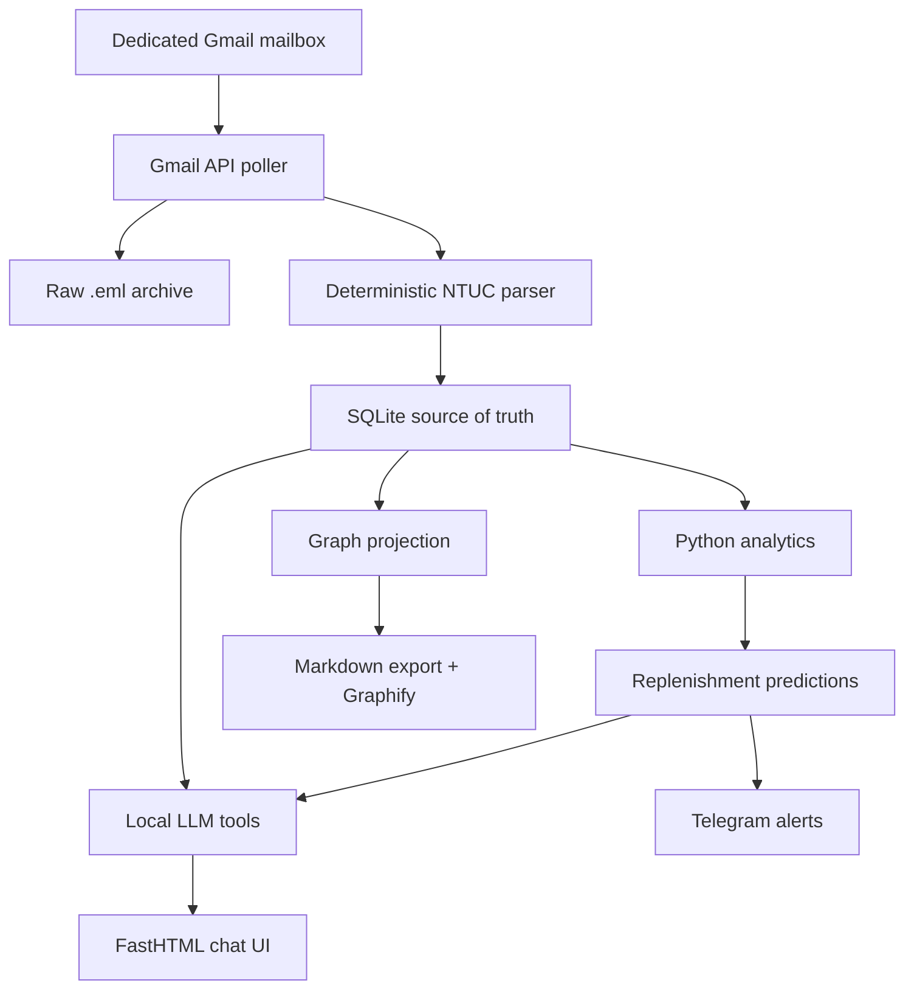

# Local Grocery Intelligence — MVP Plan

Status: design baseline  
Target host: Ubuntu, i5-3570K, 16 GB RAM, RTX 3060 12 GB  
Primary user: one household/user  
Primary retailer: NTUC FairPrice  

## 1. MVP outcome

The MVP should reliably turn forwarded NTUC transaction emails into a private purchase history, answer questions about that history through a local chatbot, calculate simple replenishment predictions, display graph relationships, and send a daily Telegram alert when an item is likely due.

The LLM is not the database and is not the forecasting engine. SQLite is authoritative; Python calculates predictions; the LLM selects tools and explains their results.



## 2. Fixed technology choices

| Concern | MVP choice | Reason |
|---|---|---|
| Runtime | Python 3.12 managed by `uv` | Matches the learning goal and keeps setup reproducible. |
| Model server | Ollama | Separate, local model process with streaming and tool calling. |
| Main model | `gemma4:12b-it-q4_K_M` | The 7.6 GB quantization fits the 12 GB RTX 3060 and has native function calling and system-prompt support. |
| Comparison model | `qwen3.5:9b-q4_K_M` | A smaller 6.6 GB fallback and useful A/B benchmark for tool accuracy and speed. |
| Model context | 8,192 tokens initially | Enough for the tool schemas and short chat history without forcing CPU spill. |
| Database | SQLite in WAL mode | Simple, inspectable, local, and appropriate for fewer than five users with brief writes. |
| Database access | Python `sqlite3` plus versioned SQL migrations | Keeps the schema and SQL visible while learning; no ORM is required. |
| Validation | Pydantic v2 | Strict boundaries for parser, tool, and API inputs/outputs. |
| UI | FastHTML + HTMX | Server-rendered interface with minimal JavaScript. |
| Chat transport | FastHTML WebSocket | One connection supports prompts, token streaming, tool status, and final answers. |
| Programmatic API | FastAPI mounted at `/api` | Useful for health, import, order, prediction, and future mobile endpoints. |
| Email access | Gmail API with OAuth and `gmail.readonly` | Least-privilege mailbox access; local Gmail message IDs provide idempotency. |
| Scheduling | Two `systemd` timers | No Redis or job broker: frequent ingestion and one daily prediction/alert run. |
| Notification | Telegram Bot API | Straightforward HTTP API and reliable personal push notifications. |
| Remote UI | Tailscale Serve to a localhost-bound app | Phone access without making the service public. |
| Graph operations | SQLite graph projection + NetworkX when traversal is needed | Exact application-owned nodes and edges remain queryable independent of Graphify. |
| Graphify | Scan generated Markdown and expose its `graph.html` as an experiment | Included for learning/visualization, not used as the operational database. |

### Why SQLite is appropriate

The expected limit is fewer than five concurrent **users**, not five permanently open database connections. A browser can keep a chat WebSocket open without keeping a SQLite transaction or connection open. Database concurrency is determined by overlapping transactions—especially overlapping writes—not by the number of connected browsers.

This application's workload is SQLite-friendly:

- Chat questions, dashboards, history, predictions, and graph exploration are predominantly reads.
- Writes such as saving one chat message, adding a shopping-list item, or recording a tool call are small and normally complete in milliseconds.
- Email ingestion is periodic rather than a continuous write stream.
- All processes and the database file run on the same Ubuntu machine; the SQLite file is never placed on a network filesystem.
- The application is single-instance and the expected database is far below SQLite's practical size limits.

SQLite WAL mode allows readers and a writer to operate at the same time, although SQLite still permits only one writer at an instant. That limitation is acceptable here because short writes can queue briefly. It avoids a separate database server, credentials, ports, upgrades, and backup procedures while keeping the data inspectable and portable.

Operating rules for reliable concurrency:

1. Open a connection for a database operation and return/close it promptly; never reserve one connection for the lifetime of a WebSocket.
2. Initialize every connection with `foreign_keys=ON` and `busy_timeout=5000`; keep the database in WAL mode.
3. Never hold a transaction while waiting for Ollama, Gmail, Graphify, Telegram, or user input.
4. Parse email and generate LLM output outside a transaction, then perform the final database changes in one short transaction.
5. Run one Uvicorn application worker initially. Its async server can handle the small number of browser/WebSocket users; synchronous repository work is dispatched without blocking the event loop.
6. Keep scheduled recomputation transactions bounded. Large calculations read into memory first and persist results in a short transaction.
7. Treat `database is locked` after the configured wait as an observable error and retry a bounded number of times rather than hiding it.

The initial operating envelope is:

| Dimension | MVP assumption |
|---|---|
| Concurrent users | Fewer than 5 |
| Open chat WebSockets | Fewer than 5 |
| Simultaneous writers | Normally 0–1; occasional brief contention |
| Application instances | 1 |
| Database location | Local SSD on the Ubuntu host |
| Long-running transactions | None |

Move to PostgreSQL when there is measured evidence of sustained concurrent writes, recurring lock timeouts despite short transactions, multiple application instances/hosts, or a requirement for clients to access the database directly over a network. The repository/service boundary and versioned migrations are intentionally designed to make that later migration contained.

Do not add LangChain, LlamaIndex, a vector database, Redis, Celery, Neo4j, or Docker to the MVP. Each can be evaluated later against a demonstrated need.

### Ollama runtime settings

Start with one loaded model and one request at a time:

```text
model: gemma4:12b-it-q4_K_M
num_ctx: 8192
temperature for tool routing: 0.1
temperature for ambiguous normalization: 0.0
OLLAMA_NUM_PARALLEL: 1
OLLAMA_MAX_LOADED_MODELS: 1
```

Use `ollama ps` during acceptance testing. The target is `100% GPU`. If 8K context causes offload or instability, reduce it to 4K before changing the model. If response speed is still unacceptable, benchmark `qwen3.5:9b-q4_K_M` and then `gemma4:e4b`. Do not use Gemma 4 26B/31B or a Q8 build: they leave too little or no room for context and runtime overhead on a 12 GB card.

Gemma 4 12B is the primary recommendation because this application depends heavily on structured tool calls and controlled system instructions. Qwen 3.5 9B remains installed only during a short evaluation, not loaded concurrently. Run both against the same acceptance-question set and retain Gemma unless it is materially slower or less reliable on the actual machine.

Use deterministic parsing before the LLM. The model should only resolve ambiguous product identity/category mappings and turn tool results into natural language.

## 3. Gmail design

Create an ordinary dedicated Gmail mailbox, for example `my.grocery.inbox@...`. This is not a Google Cloud service account. A Cloud service account cannot directly read a consumer Gmail user's mailbox; impersonation requires a managed Google Workspace domain and administrator-granted domain-wide delegation.

Recommended flow:

1. Automatically forward new NTUC/FairPrice messages from the personal mailbox to the dedicated mailbox using a narrow Gmail filter.
2. Backfill old transactions. Preserve them as `.eml` attachments when possible; the parser must also support ordinary inline forwarded messages.
3. Authorize the Ubuntu application once through the Gmail OAuth desktop flow.
4. Store the resulting refresh token outside Git with owner-only file permissions.
5. Poll every five minutes with a Gmail search query restricted by known sender/subject patterns.
6. Fetch each candidate in RAW format and archive the decoded RFC 2822 message before parsing.
7. Deduplicate first by Gmail message ID and then by `(retailer, external_order_id)`.

The initial OAuth scope is `https://www.googleapis.com/auth/gmail.readonly`. Because processing state is kept locally, the app does not need permission to modify Gmail labels. If mailbox labels become operationally useful later, explicitly migrate to `gmail.modify`.

Raw files live under this untracked structure:

```text
data/
├── grocery.sqlite3
├── raw-email/YYYY/MM/<gmail-message-id>.eml
└── extracted-email/YYYY/MM/<gmail-message-id>.html
```

The raw message is the audit record. Re-running a newer parser against the same raw input must be possible without accessing Gmail again.

## 4. Exact SQLite schema

Conventions:

- Money is stored as integer cents, never floating-point dollars.
- Timestamps are UTC ISO-8601 text; the UI displays Asia/Singapore time.
- IDs are SQLite integer primary keys except stable graph node/edge identifiers.
- JSON columns contain valid JSON text and are validated at the Python boundary.
- `EXTRACTED` means directly present in source email, `DERIVED` means deterministic Python output, `INFERRED` means an LLM conclusion, and `MANUAL` means user-confirmed knowledge.

```sql
PRAGMA foreign_keys = ON;
PRAGMA journal_mode = WAL;
PRAGMA busy_timeout = 5000;

CREATE TABLE schema_migrations (
    version       INTEGER PRIMARY KEY,
    name          TEXT NOT NULL,
    applied_at    TEXT NOT NULL
) STRICT;

CREATE TABLE email_messages (
    id                   INTEGER PRIMARY KEY,
    gmail_message_id     TEXT NOT NULL UNIQUE,
    gmail_thread_id      TEXT,
    rfc822_message_id    TEXT,
    original_message_id  TEXT,
    sender               TEXT NOT NULL,
    recipient            TEXT,
    subject              TEXT NOT NULL,
    gmail_internal_at    TEXT NOT NULL,
    source_sent_at       TEXT,
    raw_sha256           TEXT NOT NULL,
    raw_path             TEXT NOT NULL,
    html_path            TEXT,
    parse_status         TEXT NOT NULL DEFAULT 'pending'
                         CHECK (parse_status IN ('pending','parsed','ignored','failed','needs_review')),
    parser_version       TEXT,
    parse_error          TEXT,
    fetched_at           TEXT NOT NULL,
    parsed_at            TEXT
) STRICT;

CREATE INDEX idx_email_status_date
    ON email_messages(parse_status, gmail_internal_at);
CREATE INDEX idx_email_original_message_id
    ON email_messages(original_message_id);

CREATE TABLE retailers (
    id          INTEGER PRIMARY KEY,
    slug        TEXT NOT NULL UNIQUE,
    name        TEXT NOT NULL,
    country     TEXT NOT NULL DEFAULT 'SG',
    created_at  TEXT NOT NULL
) STRICT;

CREATE TABLE brands (
    id               INTEGER PRIMARY KEY,
    canonical_name   TEXT NOT NULL,
    normalized_name  TEXT NOT NULL UNIQUE,
    created_at       TEXT NOT NULL,
    updated_at       TEXT NOT NULL
) STRICT;

CREATE TABLE categories (
    id          INTEGER PRIMARY KEY,
    parent_id   INTEGER REFERENCES categories(id),
    slug        TEXT NOT NULL UNIQUE,
    name        TEXT NOT NULL,
    created_at  TEXT NOT NULL
) STRICT;

CREATE TABLE products (
    id                INTEGER PRIMARY KEY,
    canonical_key     TEXT NOT NULL UNIQUE,
    canonical_name    TEXT NOT NULL,
    normalized_name   TEXT NOT NULL,
    brand_id          INTEGER REFERENCES brands(id),
    category_id       INTEGER REFERENCES categories(id),
    package_quantity  REAL,
    package_unit      TEXT,
    variant           TEXT,
    is_active         INTEGER NOT NULL DEFAULT 1 CHECK (is_active IN (0,1)),
    created_at        TEXT NOT NULL,
    updated_at        TEXT NOT NULL
) STRICT;

CREATE INDEX idx_products_normalized_name
    ON products(normalized_name);
CREATE INDEX idx_products_category
    ON products(category_id);

CREATE TABLE retailer_products (
    id                 INTEGER PRIMARY KEY,
    retailer_id        INTEGER NOT NULL REFERENCES retailers(id),
    external_sku       TEXT,
    product_id         INTEGER NOT NULL REFERENCES products(id),
    latest_name        TEXT NOT NULL,
    latest_size_text   TEXT,
    match_status       TEXT NOT NULL DEFAULT 'provisional'
                       CHECK (match_status IN ('provisional','confirmed','rejected')),
    match_method       TEXT NOT NULL DEFAULT 'parser'
                       CHECK (match_method IN ('parser','rule','llm','manual')),
    match_confidence   REAL NOT NULL DEFAULT 1.0
                       CHECK (match_confidence >= 0.0 AND match_confidence <= 1.0),
    first_seen_at      TEXT NOT NULL,
    last_seen_at       TEXT NOT NULL,
    UNIQUE (retailer_id, external_sku)
) STRICT;

CREATE INDEX idx_retailer_products_product
    ON retailer_products(product_id);

CREATE TABLE product_aliases (
    id                INTEGER PRIMARY KEY,
    retailer_id       INTEGER REFERENCES retailers(id),
    normalized_alias  TEXT NOT NULL,
    display_alias     TEXT NOT NULL,
    product_id        INTEGER NOT NULL REFERENCES products(id),
    source_kind       TEXT NOT NULL
                      CHECK (source_kind IN ('EXTRACTED','INFERRED','MANUAL')),
    confidence        REAL NOT NULL
                      CHECK (confidence >= 0.0 AND confidence <= 1.0),
    review_status     TEXT NOT NULL DEFAULT 'unreviewed'
                      CHECK (review_status IN ('unreviewed','accepted','rejected')),
    created_at        TEXT NOT NULL,
    UNIQUE (retailer_id, normalized_alias)
) STRICT;

CREATE TABLE orders (
    id                 INTEGER PRIMARY KEY,
    retailer_id        INTEGER NOT NULL REFERENCES retailers(id),
    external_order_id  TEXT NOT NULL,
    ordered_at         TEXT NOT NULL,
    delivery_at        TEXT,
    currency           TEXT NOT NULL DEFAULT 'SGD',
    subtotal_cents     INTEGER,
    discount_cents     INTEGER NOT NULL DEFAULT 0,
    delivery_fee_cents INTEGER NOT NULL DEFAULT 0,
    service_fee_cents  INTEGER NOT NULL DEFAULT 0,
    tax_cents          INTEGER,
    total_cents        INTEGER NOT NULL,
    status             TEXT NOT NULL DEFAULT 'completed'
                       CHECK (status IN ('placed','completed','cancelled','refunded','unknown')),
    created_at         TEXT NOT NULL,
    updated_at         TEXT NOT NULL,
    UNIQUE (retailer_id, external_order_id)
) STRICT;

CREATE INDEX idx_orders_ordered_at
    ON orders(ordered_at);

CREATE TABLE order_source_emails (
    order_id          INTEGER NOT NULL REFERENCES orders(id) ON DELETE CASCADE,
    email_message_id  INTEGER NOT NULL REFERENCES email_messages(id) ON DELETE CASCADE,
    source_role       TEXT NOT NULL DEFAULT 'confirmation'
                      CHECK (source_role IN ('confirmation','amendment','receipt','refund','other')),
    PRIMARY KEY (order_id, email_message_id)
) STRICT, WITHOUT ROWID;

CREATE TABLE order_items (
    id                    INTEGER PRIMARY KEY,
    order_id              INTEGER NOT NULL REFERENCES orders(id) ON DELETE CASCADE,
    line_number           INTEGER NOT NULL,
    retailer_product_id   INTEGER NOT NULL REFERENCES retailer_products(id),
    raw_name              TEXT NOT NULL,
    quantity              REAL NOT NULL CHECK (quantity > 0),
    unit                  TEXT NOT NULL DEFAULT 'item',
    unit_price_cents      INTEGER,
    gross_cents           INTEGER,
    discount_cents        INTEGER NOT NULL DEFAULT 0,
    net_cents             INTEGER NOT NULL,
    created_at            TEXT NOT NULL,
    UNIQUE (order_id, line_number)
) STRICT;

CREATE INDEX idx_order_items_product
    ON order_items(retailer_product_id);

CREATE VIEW purchase_history AS
SELECT
    oi.id AS order_item_id,
    o.id AS order_id,
    o.ordered_at,
    o.external_order_id,
    r.slug AS retailer,
    p.id AS product_id,
    p.canonical_name,
    p.category_id,
    oi.quantity,
    oi.unit,
    oi.unit_price_cents,
    oi.net_cents
FROM order_items oi
JOIN orders o ON o.id = oi.order_id
JOIN retailers r ON r.id = o.retailer_id
JOIN retailer_products rp ON rp.id = oi.retailer_product_id
JOIN products p ON p.id = rp.product_id
WHERE o.status = 'completed';

CREATE TABLE product_metrics (
    product_id              INTEGER PRIMARY KEY REFERENCES products(id) ON DELETE CASCADE,
    purchase_count          INTEGER NOT NULL,
    first_purchased_at      TEXT NOT NULL,
    last_purchased_at       TEXT NOT NULL,
    median_interval_days    REAL,
    interval_mad_days       REAL,
    mean_quantity           REAL,
    median_unit_price_cents INTEGER,
    price_trend_pct         REAL,
    calculated_at           TEXT NOT NULL,
    algorithm_version       TEXT NOT NULL
) STRICT;

CREATE TABLE replenishment_predictions (
    id                    INTEGER PRIMARY KEY,
    product_id            INTEGER NOT NULL REFERENCES products(id) ON DELETE CASCADE,
    generated_at          TEXT NOT NULL,
    expected_at           TEXT NOT NULL,
    window_start_at       TEXT NOT NULL,
    window_end_at         TEXT NOT NULL,
    due_score             REAL NOT NULL CHECK (due_score >= 0.0 AND due_score <= 1.0),
    confidence            REAL NOT NULL CHECK (confidence >= 0.0 AND confidence <= 1.0),
    history_count         INTEGER NOT NULL,
    median_interval_days  REAL NOT NULL,
    interval_mad_days     REAL NOT NULL,
    algorithm_version     TEXT NOT NULL,
    evidence_json         TEXT NOT NULL DEFAULT '{}',
    status                TEXT NOT NULL DEFAULT 'active'
                          CHECK (status IN ('active','notified','resolved','dismissed','expired')),
    resolved_order_item_id INTEGER REFERENCES order_items(id),
    UNIQUE (product_id, generated_at, algorithm_version)
) STRICT;

CREATE INDEX idx_predictions_due
    ON replenishment_predictions(status, due_score, window_end_at);

CREATE TABLE co_purchase_edges (
    product_a_id    INTEGER NOT NULL REFERENCES products(id) ON DELETE CASCADE,
    product_b_id    INTEGER NOT NULL REFERENCES products(id) ON DELETE CASCADE,
    order_count     INTEGER NOT NULL,
    total_orders    INTEGER NOT NULL,
    support         REAL NOT NULL,
    confidence_ab   REAL NOT NULL,
    confidence_ba   REAL NOT NULL,
    lift            REAL NOT NULL,
    calculated_at   TEXT NOT NULL,
    algorithm_version TEXT NOT NULL,
    CHECK (product_a_id < product_b_id),
    PRIMARY KEY (product_a_id, product_b_id)
) STRICT, WITHOUT ROWID;

CREATE TABLE shopping_lists (
    id          INTEGER PRIMARY KEY,
    name        TEXT NOT NULL,
    status      TEXT NOT NULL DEFAULT 'open'
                CHECK (status IN ('open','completed','archived')),
    created_at  TEXT NOT NULL,
    completed_at TEXT
) STRICT;

CREATE UNIQUE INDEX idx_one_open_default_list
    ON shopping_lists(status) WHERE status = 'open';

CREATE TABLE shopping_list_items (
    id                    INTEGER PRIMARY KEY,
    shopping_list_id      INTEGER NOT NULL REFERENCES shopping_lists(id) ON DELETE CASCADE,
    product_id            INTEGER REFERENCES products(id),
    free_text             TEXT,
    desired_quantity      REAL NOT NULL DEFAULT 1 CHECK (desired_quantity > 0),
    desired_unit          TEXT NOT NULL DEFAULT 'item',
    reason_kind           TEXT NOT NULL DEFAULT 'manual'
                          CHECK (reason_kind IN ('manual','chat','prediction','forgotten_item')),
    prediction_id         INTEGER REFERENCES replenishment_predictions(id),
    status                TEXT NOT NULL DEFAULT 'needed'
                          CHECK (status IN ('needed','purchased','dismissed')),
    added_at              TEXT NOT NULL,
    purchased_at          TEXT,
    matched_order_item_id INTEGER REFERENCES order_items(id),
    CHECK (product_id IS NOT NULL OR free_text IS NOT NULL)
) STRICT;

CREATE TABLE conversations (
    id          INTEGER PRIMARY KEY,
    title       TEXT,
    created_at  TEXT NOT NULL,
    updated_at  TEXT NOT NULL
) STRICT;

CREATE TABLE chat_messages (
    id               INTEGER PRIMARY KEY,
    conversation_id  INTEGER NOT NULL REFERENCES conversations(id) ON DELETE CASCADE,
    role             TEXT NOT NULL CHECK (role IN ('system','user','assistant','tool')),
    content          TEXT NOT NULL,
    model            TEXT,
    created_at       TEXT NOT NULL
) STRICT;

CREATE INDEX idx_chat_messages_conversation
    ON chat_messages(conversation_id, id);

CREATE TABLE tool_calls (
    id                    INTEGER PRIMARY KEY,
    conversation_id       INTEGER NOT NULL REFERENCES conversations(id) ON DELETE CASCADE,
    assistant_message_id  INTEGER REFERENCES chat_messages(id) ON DELETE SET NULL,
    tool_name             TEXT NOT NULL,
    arguments_json        TEXT NOT NULL,
    result_json           TEXT,
    status                TEXT NOT NULL CHECK (status IN ('requested','succeeded','failed','denied')),
    started_at            TEXT NOT NULL,
    finished_at           TEXT,
    error                 TEXT
) STRICT;

CREATE TABLE notification_channels (
    id                 INTEGER PRIMARY KEY,
    channel_type       TEXT NOT NULL CHECK (channel_type IN ('telegram','whatsapp','web')),
    destination        TEXT NOT NULL,
    secret_env_prefix  TEXT NOT NULL,
    enabled            INTEGER NOT NULL DEFAULT 1 CHECK (enabled IN (0,1)),
    created_at         TEXT NOT NULL,
    UNIQUE (channel_type, destination)
) STRICT;

CREATE TABLE alerts (
    id              INTEGER PRIMARY KEY,
    alert_type      TEXT NOT NULL CHECK (alert_type IN ('due_soon','overdue','forgotten_item','price_change')),
    product_id      INTEGER REFERENCES products(id),
    prediction_id   INTEGER REFERENCES replenishment_predictions(id),
    dedupe_key      TEXT NOT NULL UNIQUE,
    title           TEXT NOT NULL,
    body            TEXT NOT NULL,
    severity        TEXT NOT NULL DEFAULT 'info' CHECK (severity IN ('info','warning','urgent')),
    scheduled_at    TEXT NOT NULL,
    status          TEXT NOT NULL DEFAULT 'pending'
                    CHECK (status IN ('pending','sending','sent','failed','cancelled')),
    created_at      TEXT NOT NULL,
    sent_at         TEXT
) STRICT;

CREATE INDEX idx_alerts_pending
    ON alerts(status, scheduled_at);

CREATE TABLE alert_deliveries (
    id                   INTEGER PRIMARY KEY,
    alert_id             INTEGER NOT NULL REFERENCES alerts(id) ON DELETE CASCADE,
    channel_id           INTEGER NOT NULL REFERENCES notification_channels(id),
    attempt_number       INTEGER NOT NULL,
    status               TEXT NOT NULL CHECK (status IN ('pending','sent','failed')),
    provider_message_id  TEXT,
    error                TEXT,
    attempted_at         TEXT NOT NULL,
    UNIQUE (alert_id, channel_id, attempt_number)
) STRICT;

CREATE TABLE graph_nodes (
    id               TEXT PRIMARY KEY,
    node_type        TEXT NOT NULL,
    entity_table     TEXT NOT NULL,
    entity_id        INTEGER NOT NULL,
    label            TEXT NOT NULL,
    properties_json  TEXT NOT NULL DEFAULT '{}',
    updated_at       TEXT NOT NULL,
    UNIQUE (entity_table, entity_id)
) STRICT, WITHOUT ROWID;

CREATE TABLE graph_edges (
    id                TEXT PRIMARY KEY,
    source_node_id    TEXT NOT NULL REFERENCES graph_nodes(id) ON DELETE CASCADE,
    predicate         TEXT NOT NULL,
    target_node_id    TEXT NOT NULL REFERENCES graph_nodes(id) ON DELETE CASCADE,
    provenance_kind   TEXT NOT NULL
                      CHECK (provenance_kind IN ('EXTRACTED','DERIVED','INFERRED','MANUAL')),
    source_email_id   INTEGER REFERENCES email_messages(id),
    method            TEXT,
    confidence        REAL CHECK (confidence IS NULL OR (confidence >= 0.0 AND confidence <= 1.0)),
    evidence_json     TEXT NOT NULL DEFAULT '{}',
    valid_from        TEXT,
    valid_to          TEXT,
    updated_at        TEXT NOT NULL,
    UNIQUE (source_node_id, predicate, target_node_id, provenance_kind, method)
) STRICT, WITHOUT ROWID;

CREATE INDEX idx_graph_edges_source
    ON graph_edges(source_node_id, predicate);
CREATE INDEX idx_graph_edges_target
    ON graph_edges(target_node_id, predicate);
```

### Entity rules

1. A `product` is a canonical SKU-level concept: brand + item + variant + package size. “Meiji Fresh Milk 2L” and “Meiji Fresh Milk 1L” are different products.
2. A `retailer_product` is the retailer's listing/SKU mapped to that canonical product.
3. Unknown items create provisional products; ingestion must not stop while waiting for manual cleanup.
4. The normalization review screen can merge provisional products later. A merge rewrites foreign keys in one transaction and preserves the losing name as an alias.
5. Orders and order items are immutable parsed facts. Corrections are applied by a reparse transaction from the preserved raw email, not by silently editing totals.
6. Derived tables (`product_metrics`, `replenishment_predictions`, `co_purchase_edges`, `graph_nodes`, `graph_edges`) are rebuildable from factual tables.

### Initial graph predicates

| Predicate | Example | Provenance |
|---|---|---|
| `CONTAINS` | order → product | EXTRACTED |
| `SOLD_BY` | product → retailer | EXTRACTED |
| `MADE_BY` | product → brand | EXTRACTED or MANUAL |
| `IN_CATEGORY` | product → category | INFERRED or MANUAL |
| `OFTEN_BOUGHT_WITH` | product → product | DERIVED |
| `LIKELY_DUE` | product → prediction | DERIVED |
| `POSSIBLE_SUBSTITUTE` | product → product | INFERRED, then MANUAL if confirmed |
| `ADDED_TO` | product → shopping list | EXTRACTED from user action |

Every inferred edge must carry a confidence and evidence. The chatbot must identify inferred facts as suggestions, not certainties.

## 5. Baseline prediction algorithm

The MVP predicts exact canonical products, not broad categories. Category-level forecasting comes later.

Eligibility:

- At least four completed purchases, which provides at least three intervals.
- Ignore cancelled/refunded orders.
- Collapse multiple quantities of the same product in one order into one purchase event for interval calculation.

For each eligible product:

1. Sort purchase dates.
2. Calculate day intervals between purchases.
3. Calculate median interval `m` and median absolute deviation `mad`.
4. Set `tolerance = max(2 days, 1.5 × mad, 0.15 × m)`.
5. Set `expected_at = last_purchase + m`.
6. Set the predicted window to `expected_at ± tolerance`.
7. Set `due_score = clamp((days_since_last - (m - tolerance)) / (2 × tolerance), 0, 1)`.
8. Set `confidence = min(1, interval_count / 6) × (1 / (1 + mad / m))`.

Send a `due_soon` alert when `due_score >= 0.75` and `confidence >= 0.55`. Use a dedupe key such as `due-soon:<product-id>:<ISO-week>` so repeated daily runs do not spam the user. Resolve an active prediction when a later completed order contains that product.

This is deliberately a transparent statistical baseline. Store algorithm versions and prediction history so a later ML approach can be measured against it.

## 6. Chatbot design

Build a small explicit agent loop using the Ollama Python client. Do not let the model execute SQL or arbitrary Python.

Initial read tools:

```text
search_products(query)
get_purchase_history(product_id, limit=20)
get_recent_orders(days=90, limit=20)
get_price_history(product_id)
get_due_products(min_confidence=0.55)
get_co_purchases(product_id, min_support=0.10)
get_graph_neighbors(node_id, predicates=None, depth=1)
get_open_shopping_list()
```

Initial write tools:

```text
add_shopping_item(product_id=None, free_text=None, quantity=1, unit='item')
mark_shopping_item_purchased(item_id)
dismiss_shopping_item(item_id)
confirm_product_match(retailer_product_id, product_id)
```

Write-tool policy:

- A tool call is validated with Pydantic.
- The tool performs a normal application service operation, not model-authored SQL.
- The result is written to `tool_calls`.
- Destructive or ambiguous writes require confirmation in the web UI.
- The assistant may only claim success after the tool returns success.

The UI has five screens:

1. **Dashboard** — due items, ingestion health, latest order, and open list.
2. **Chat** — streamed conversation with visible tool activity.
3. **Purchase history** — orders, products, quantities, and price history.
4. **Review queue** — failed parses and provisional product matches.
5. **Graph** — app-owned neighborhood explorer plus a link to the latest Graphify HTML artifact.

Use FastHTML for HTML pages/fragments and the WebSocket chat route. Mount FastAPI at `/api` for JSON endpoints such as `/api/health`, `/api/orders`, `/api/predictions`, and `/api/import/status`. Both layers call the same services and repositories.

## 7. Graphify in version one

Graphify is an optional projection, not a dependency in the ingestion/chat/alert path.

The application exports selected nodes as Markdown:

```text
knowledge/
├── products/<canonical-key>.md
├── brands/<brand>.md
├── categories/<category>.md
├── orders/<retailer>-<order-id>.md
├── insights/co-purchases.md
└── predictions/due-soon.md
```

Each document contains stable IDs, typed links, provenance, dates, and confidence. A separate command runs Graphify over `knowledge/` and places artifacts in an untracked `graphify-out/` directory. The Graph screen can link to the latest `graph.html`.

Do not generate Graphify's internal `graph.json` directly; that would couple the application to a third-party internal format. If Graphify produces poor grocery relationships, keep the export and record the result—the core app still has exact `graph_nodes` and `graph_edges`.

## 8. Notifications

### MVP: Telegram

Create a private Telegram bot and capture the allowed personal chat ID. The app sends through the Bot API's `sendMessage` method. Store the bot token in an environment file, never in SQLite or Git. Reject any incoming chat ID not on the allowlist.

Example daily message:

```text
Grocery check — 10 Aug

Likely due
• Meiji Fresh Milk 2L — expected now; confidence 82%
• Eggs 10-pack — expected in 2–4 days; confidence 66%

Possible omission
• Bread appears in 74% of orders containing milk and eggs.

Open the dashboard: <Tailscale URL>
```

Use Telegram only for notifications in the MVP. Continue conversations in the FastHTML UI. Two-way Telegram chat can reuse the agent service later.

### Later: WhatsApp

Use only Meta's official WhatsApp Cloud API. It requires a Meta business portfolio, WhatsApp Business Account, and business phone number, and proactive messaging may require approved templates. This setup and policy surface add no value to the knowledge-graph learning goal, so WhatsApp is explicitly outside MVP scope.

## 9. Processes and schedules

Run three local components:

```text
ollama.service
grocery-web.service          # FastHTML/FastAPI on 127.0.0.1:8000
grocery-ingest.timer         # every 5 minutes
grocery-daily.timer          # 08:00 Asia/Singapore
```

`grocery-ingest` performs Gmail fetch → raw archive → parse → normalize → transactional upsert. `grocery-daily` refreshes metrics, predictions, graph projection, Markdown/Graphify export, and pending alerts before delivering Telegram messages.

The web service must not own the scheduler. Separating scheduled commands prevents missed or duplicated jobs when the UI process restarts.

## 10. Suggested repository layout

```text
jdsg-knowledge-graph-shopping/
├── pyproject.toml
├── uv.lock
├── .env.example
├── migrations/
│   └── 001_initial.sql
├── app/
│   ├── main.py
│   ├── config.py
│   ├── api/
│   ├── web/
│   ├── chat/
│   ├── db/
│   ├── email/
│   ├── products/
│   ├── analytics/
│   ├── graph/
│   └── notifications/
├── commands/
│   ├── ingest.py
│   ├── recompute.py
│   ├── notify.py
│   └── export_graph.py
├── knowledge/                 # generated, untracked
├── graphify-out/              # generated, untracked
├── data/                      # private, untracked
├── tests/
│   ├── fixtures/email/
│   ├── test_email_parser.py
│   ├── test_idempotency.py
│   ├── test_normalization.py
│   ├── test_predictions.py
│   ├── test_tools.py
│   └── test_notifications.py
└── deploy/systemd/
```

## 11. MVP milestones and exit criteria

### Milestone 0 — Samples and skeleton

- Collect 10–20 representative NTUC emails with sensitive fixtures sanitized for tests.
- Create the `uv` project, configuration loader, logging, and health page.
- Create `.gitignore` before any real email, database, OAuth token, or Telegram token is added.

Exit: the FastHTML page loads locally and no sensitive file appears in Git status.

### Milestone 1 — Database and manual import

- Apply migration `001_initial.sql`.
- Import a local `.eml` file and preserve its raw bytes/hash.
- Parse order ID, date, line items, quantities, prices, discounts, and totals.
- Display an order and its line items.

Exit: fixture totals reconcile exactly and importing the same message twice creates no duplicate email, order, or line item.

### Milestone 2 — Gmail ingestion

- Complete one-time OAuth setup for the dedicated mailbox.
- Search, download, archive, and process forwarded messages.
- Add parse failure/review states and an ingestion status page.
- Install the five-minute systemd timer.

Exit: a newly forwarded NTUC email appears once in the UI without manual app intervention.

### Milestone 3 — Product normalization

- Normalize punctuation, case, pack-size notation, and known aliases deterministically.
- Use Qwen only when deterministic matching is inconclusive.
- Add the review/merge UI and alias preservation.

Exit: repeat purchases map to the same canonical product, uncertain matches remain visibly provisional, and manual corrections survive reprocessing.

### Milestone 4 — Analytics and knowledge graph

- Compute product metrics, replenishment predictions, and co-purchase edges.
- Build the app-owned graph projection with provenance/evidence.
- Export Markdown and run Graphify.
- Display the due-items dashboard and graph artifact.

Exit: every displayed prediction can show its purchase dates, calculation, confidence, and algorithm version.

### Milestone 5 — Local chatbot

- Run `gemma4:12b-it-q4_K_M` in Ollama with 8K context.
- Benchmark `qwen3.5:9b-q4_K_M` against the same tool-calling acceptance set before fixing the final model choice.
- Implement the explicit tool loop and read-only tools first.
- Add WebSocket token streaming and persist chat/tool history.
- Add shopping-list write tools with confirmation.

Exit: the chatbot answers five acceptance questions using tool results, never invented database facts, and the model remains fully GPU-loaded.

Acceptance questions:

1. What did I buy in my latest NTUC order?
2. When did I last buy milk and how much did it cost?
3. What is likely due this week, and why?
4. What do I commonly buy with eggs?
5. Add the two highest-confidence due items to my shopping list.

### Milestone 6 — Telegram and remote access

- Send idempotent daily Telegram alerts.
- Bind the web app to localhost and expose it with Tailscale Serve.
- Confirm desktop and phone access.
- Add database and raw-email backup instructions.

Exit: one scheduled alert arrives, links to the private dashboard, and rerunning the job does not duplicate the alert.

### Milestone 7 — Hardening and MVP release

- Test parser regression across all fixtures.
- Test failed Gmail/Ollama/Telegram calls and retries.
- Add health indicators for last successful ingestion, prediction, and notification.
- Document restore and reparse procedures.

Exit: the system can rebuild every derived table and graph artifact from the SQLite facts and archived raw emails.

## 12. Explicitly deferred

- WhatsApp notifications or chat
- Embeddings/RAG and vector storage
- Neo4j or another graph database
- Recipe/catalogue/nutrition enrichment
- Category-level and seasonal ML forecasting
- Multi-user authentication and household sharing
- Public Internet deployment
- Automatic buying or retailer checkout

## 13. First implementation slice

The first coding slice should stop after one saved email travels end to end:

```text
sample .eml
  → archived source record
  → parsed order + items in SQLite
  → order history page
  → repeat import proves idempotency
```

Do not install Ollama, Graphify, Gmail OAuth, or Telegram until this slice passes. It isolates the most project-specific risk: whether the real NTUC email format can be parsed accurately and reproducibly.

## 14. Primary references

- [Gmail API Python quickstart](https://developers.google.com/workspace/gmail/api/quickstart/python)
- [Gmail messages API](https://developers.google.com/workspace/gmail/api/reference/rest/v1/users.messages)
- [Google service-account authorization](https://developers.google.com/identity/protocols/oauth2/service-account)
- [Ollama Qwen 3.5 tags](https://ollama.com/library/qwen3.5/tags)
- [Ollama Gemma 4 tags](https://ollama.com/library/gemma4/tags)
- [Google Gemma 4 model card](https://ai.google.dev/gemma/docs/core/model_card_4)
- [Google Gemma 4 function calling](https://ai.google.dev/gemma/docs/capabilities/text/function-calling-gemma4)
- [Ollama tool calling](https://docs.ollama.com/capabilities/tool-calling)
- [Ollama context-length guidance](https://docs.ollama.com/context-length)
- [FastHTML official documentation](https://www.fastht.ml/docs/index.html)
- [FastHTML chatbot and WebSocket examples](https://fastht.ml/docs/tutorials/by_example.html)
- [Graphify tutorial](https://graphify.com/docs/tutorial)
- [Telegram Bot API](https://core.telegram.org/bots/api)
- [Meta WhatsApp Cloud API collection](https://www.postman.com/meta/whatsapp-business-platform/documentation/wlk6lh4/whatsapp-cloud-api)
